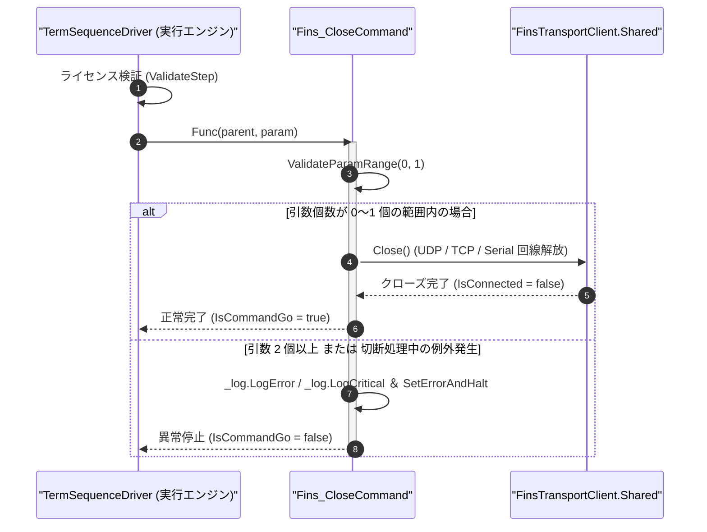

# コマンドリファレンス：Fins_Close

## 概要

**Fins_Close** は、`Fins_Open` によって開設された OMRON FINS / HostLink 通信回線（UDP ソケット、TCP ストリーム、またはシリアル COM ポート）を `FinsTransportClient.Shared.Close()` により安全に切断し、OS リソースを解放する通信制御系コマンドです。
一連の PLC 通信シーケンスの終了時や、条件分岐後のクローズ処理で使用します。

---

## 💡 書式・パラメータ仕様

### コマンド構文

```csv
,SEQUENCE, [ステップキー], Fins_Close, "[Option]"
```

※ 標準では引数なしで使用しますが、互換性のため `ParameterSpec` および `ValidateParamRange(0, 1)` により **0〜1 個の引数を許容** します（2 個以上の引数を指定した場合はエラー停止します）。

### パラメータ（引数）一覧

| 引数位置 | 引数名 | 必須/任意 | 説明・制約 |
| :--- | :--- | :---: | :--- |
| 第 1 引数 | `Option` | 任意 | 互換用の予約引数（省略時既定値: `""`）。指定された値は参照されず、接続中の OMRON FINS / HostLink 通信回線を安全に切断し解放します。 |

---

## 🔄 特殊置換規約・分岐規約の適用

本コマンドの引数における特殊記法および解釈ルールです。
* **動的置換（`$`）**: 任意の第 1 引数 `Option` に対して構文上 `$PARAMキー$` 動的置換が可能ですが、互換用予約引数のため展開後の値はクローズ動作では参照されません。（適用可能な引数: 第 1 引数）
* **ジャンプ先指定（`#`）**: 本コマンドはジャンプ制御を行わないため適用されません。（適用可能な引数: 非適用）
* **共通コマンド指定（`@`）**: 本コマンドは外部マクロを呼び出さないため、共通コマンド呼び出し記法は適用されません。（適用可能な引数: 非適用）
* **カンマのエスケープ**: 第 1 引数にカンマを含む文字列を指定する場合は、必ず `"..."` と二重引用符で囲んで記述します。
* **エイリアス（別名）**: `Analysis_Fins_Close`, `Sqn_Fins_Close`

---

## 💡 動作例（正しい構文での記述例）

### スクリプト記述例

※COMMAND ブロック配下の子要素行（PARAM, SEQUENCE）は必ず行頭カンマから開始し、スペースインデントや行末コメント（`;`）は記述しないでください。

```csv
COMMAND, "SAMPLE_FINS_CLOSE", "DM200_VAL"
,PARAM, "DM200_VAL", Work, "DM200読出値", ""
; 1. FINS/TCP で接続
,SEQUENCE, 010, Fins_Open, "192.168.250.1", "9600", "TCP"
; 2. DM200 から 1 ワードを読出し DM200_VAL へ格納
,SEQUENCE, 020, Fins_ReadWord, "DM200", 1, "DM200_VAL", "HEX"
; 3. 読出値が 0x0064 (100) 以上か判定（未満時は #NG_PROC# へ分岐）
,SEQUENCE, 030, Judge, "GE", "$DM200_VAL$", "0x0064", "#NG_PROC#"
; 4. 通信回線をクローズして正常終了
,SEQUENCE, 040, Fins_Close
,SEQUENCE, 050, Exit, "$DM200_VAL$", 0
; 条件不成立時のクローズ＆異常終了経路
,SEQUENCE, #NG_PROC#, Fins_Close
,SEQUENCE, 070, Exit, "NG", -1
```

### 実行時の挙動・変数変化

* **実行前の状態**: Term 通信エンジンが初期化され、変数プール（`PARAM`）に `"DM200_VAL"` が定義されている状態。
* **実行後の状態**: `Fins_ReadWord` で読み出された 16 進値（例: `"0x00C8"`）が `"DM200_VAL"` に格納され、`Judge` の比較結果に応じて正常終了経路または `#NG_PROC#` 経路のいずれでも `Fins_Close` が実行されて通信回線が安全に切断されます。

---

## 🔄 動作フロー（シーケンス図）



---

## 🚫 エラーハンドリング・安全設計（仕様制限）

入力データの異常や実行時エラーに対し、解析・実行エンジンが実行するセーフティ規約です。

1. **引数個数バリデーション保護**:
   - 引数が 2 個以上指定された場合（`ValidateParamRange(0, 1)` 違反）は、`_log.LogError` に詳細を記録し、`SetErrorAndHalt` により実行を安全に停止します。
2. **回線クローズ時の例外防御**:
   - 未接続状態での重複呼び出し時もエラーにならず安全に完了します。万一ソケットまたはシリアルポート解放中に予期せぬ例外が発生した場合は、`catch` 節で `_log.LogCritical` に記録し `SetErrorAndHalt(-1, ex.Message)` でクラッシュを防ぎます。

---

## 🧪 ユニットテスト仕様

本コマンドクラス（`Fins_CloseCommand.cs`）に実装されている `RunUnitTest()` メソッドが検証するユニットテストの仕様です。

### テスト実行前提条件

* **実行トリガー**: `RunUnitTest()` メソッドの呼び出し
* **有効化条件**: システム全体の最小ログレベル（`ErrorLogger.MinimumLevel`）が `LogLevel.Test` であること（それ以外の場合は無効化ガードにより早期リターン）
* **検証結果出力**: `_log.LogTest` によるログ出力。検証失敗時は `_log.LogError`、予期せぬ例外発生時は `_log.LogCritical` で記録し、`finally` ブロックで `FinsTransportClient.Shared.IsSimulationMode` を開始前の状態へ復元します。

### テストケース一覧

| No | テストカテゴリ | テスト条件（入力値） | 期待される結果（出力値） | 検証の目的 / 観点 |
| :---: | :--- | :--- | :--- | :--- |
| **1** | 正常系 | `FinsTransportClient.Shared.IsSimulationMode = true` 環境下で引数なしで `Fins_Close` を実行 | `!param.HasError` かつ `param.IsCommandGo == true`、`!FinsTransportClient.Shared.IsConnected` となる | FINS／HostLink 通信回線の正常切断および接続状態解除の検証 |
| **2** | 異常系 | 余剰引数 2 個（`"EXTRA1"`, `"EXTRA2"`）を指定して `Func(null, invalidParam)` を実行 | `ValidateParamRange(0, 1)` により拒否され、`invalidParam.HasError == true` かつ `!invalidParam.IsCommandGo` となる | 引数上限超過時のバリデーション拒否検証 |
