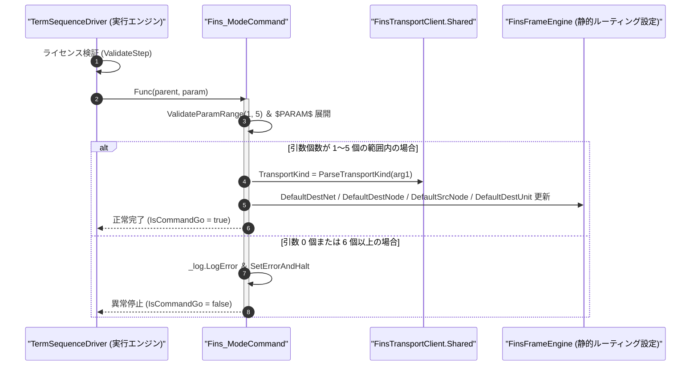

# コマンドリファレンス：Fins_Mode

## 概要

**Fins_Mode** は、OMRON FINS / HostLink 通信における物理トランスポート方式（`UDP` / `TCP` / `Serial`）および FINS ルーティングヘッダ情報（宛先ネットワーク番号 `DNA`、宛先ノード番号 `DA1`、自局ノード番号 `SA1`、宛先ユニット番号／HostLink 局番 `DA2`）をメモリ上で動的に設定・切り替える通信設定系コマンドです。
シーケンス実行中に接続方式やアクセス先ネットワーク・局番を切り替える用途で使用します。

---

## 💡 書式・パラメータ仕様

### コマンド構文

```csv
,SEQUENCE, [ステップキー], Fins_Mode, [Protocol], "[DestNet: 0]", "[DestNode: 0]", "[SrcNode: 1]", "[UnitNo: 0]"
```

※ `Func` 内の `ValidateParamRange(1, 5)` により **最低 1 引数の指定が必須** です（引数 0 個または 6 個以上はエラー停止します。なお `ParameterSpec` 上は各引数に既定値 `"UDP"`, `"0"`, `"0"`, `"1"`, `"0"` が定義されています）。

### パラメータ（引数）一覧

| 引数位置 | 引数名 | 必須/任意 | 説明・制約 |
| :--- | :--- | :---: | :--- |
| 第 1 引数 | `Protocol` | **必須** | 使用する通信トランスポート方式（`"TCP"` / `"FINS/TCP"` / `"FINSTCP"` は TCP、`"SERIAL"` / `"COM"` / `"HOSTLINK"` / `"RS232C"` は Serial、それ以外［`"UDP"` 等］は UDP として設定。空文字 `""` 指定時は現在値を維持）。 |
| 第 2 引数 | `DestNet` | 任意 | 宛先ネットワークアドレス `DNA`（`byte.TryParse` による `0`〜`255` の整数文字列、FINS プロトコル推奨範囲 `0`〜`127`、既定: `"0"`。空文字や範囲外・非数値時は現在値を維持）。 |
| 第 3 引数 | `DestNode` | 任意 | 宛先ノードアドレス `DA1`（`byte.TryParse` による `0`〜`255` の整数文字列、FINS プロトコル推奨範囲 `0`〜`254`、既定: `"0"`。空文字や範囲外・非数値時は現在値を維持）。 |
| 第 4 引数 | `SrcNode` | 任意 | 送信元（PC 側）ノードアドレス `SA1`（`byte.TryParse` による `0`〜`255` の整数文字列、FINS プロトコル推奨範囲 `0`〜`254`、既定: `"1"`。空文字や範囲外・非数値時は現在値を維持）。 |
| 第 5 引数 | `UnitNo` | 任意 | 宛先ユニットアドレス `DA2` 兼シリアル HostLink 号機番号（`byte.TryParse` による `0`〜`255` の整数文字列、HostLink 時の推奨局番 `0`〜`31`、既定: `"0"`。`DefaultDestUnit` と `DefaultHostLinkUnitNo` の双方を更新し、空文字や範囲外・非数値時は現在値を維持）。 |

---

## 🔄 特殊置換規約・分岐規約の適用

本コマンドの引数における特殊記法および解釈ルールです。
* **動的置換（`$`）**: 引数内で `$PARAMキー$` のように記述すると、実行時に変数プール（PARAM）の値へ動的置換されます。（適用可能な引数: 全引数対応）
* **ジャンプ先指定（`#`）**: 本コマンドはジャンプ制御を行わないため適用されません。（適用可能な引数: 非適用）
* **共通コマンド指定（`@`）**: 本コマンドは外部マクロを呼び出さないため、共通コマンド呼び出し記法は適用されません。（適用可能な引数: 非適用）
* **カンマのエスケープ**: 引数自体にカンマを含める場合は、必ず `"..."` と二重引用符で囲んで記述します。
* **エイリアス（別名）**: `Analysis_Fins_Mode`, `Sqn_Fins_Mode`

---

## 💡 動作例（正しい構文での記述例）

### スクリプト記述例

※COMMAND ブロック配下の子要素行（PARAM, SEQUENCE）は必ず行頭カンマから開始し、スペースインデントや行末コメント（`;`）は記述しないでください。

```csv
COMMAND, "SAMPLE_FINS_MODE", "RESULT_DM0"
,PARAM, "RESULT_DM0", Work, "DM0読出結果", ""
; 1. FINS/UDP、DNA=0, DA1=1, SA1=10, CPUユニット(DA2=0) に設定
,SEQUENCE, 010, Fins_Mode, "UDP", 0, 1, 10, 0
,SEQUENCE, 020, Fins_Open, "192.168.250.1", "9600", "UDP"
; 2. DM0 から 1 ワード読出し RESULT_DM0 へ格納
,SEQUENCE, 030, Fins_ReadWord, "DM0", 1, "RESULT_DM0", "HEX"
; 3. 読出値が 0x0000 でないか判定（ゼロ時は #NG_PROC# へ分岐）
,SEQUENCE, 040, Judge, "NEQ", "$RESULT_DM0$", "0x0000", "#NG_PROC#"
,SEQUENCE, 050, Fins_Close
,SEQUENCE, 060, Exit, "$RESULT_DM0$", 0
; 条件不成立時のクローズ＆異常終了経路
,SEQUENCE, #NG_PROC#, Fins_Close
,SEQUENCE, 080, Exit, "NG", -1
```

### 実行時の挙動・変数変化

* **実行前の状態**: Term 通信エンジンが初期化され、変数プール（`PARAM`）に `"RESULT_DM0"` が定義されている状態。
* **実行後の状態**: `Fins_Mode` により通信を行わずメモリ上のトランスポート種別およびルーティング情報（`DNA=0`, `DA1=1`, `SA1=10`, `DA2=0`）が更新されます。続く `Fins_ReadWord` で取得された値が `"RESULT_DM0"` に格納され、`Judge` で判定後に回線をクローズします。

---

## 🔄 動作フロー（シーケンス図）



---

## 🚫 エラーハンドリング・安全設計（仕様制限）

入力データの異常や実行時エラーに対し、解析・実行エンジンが実行するセーフティ規約です。

1. **引数個数バリデーション保護**:
   - 引数が省略された場合（0 個）または 6 個以上指定された場合は、`ValidateParamRange(1, 5)` により `_log.LogError` に詳細を記録し、`SetErrorAndHalt` で停止します。
2. **範囲外数値の安全フォールバックおよび例外防御**:
   - 本コマンドは物理通信を行わず設定プロパティのみを更新します。第 2〜第 5 引数に `0`〜`255` 以外の文字列や空文字が渡された場合は、`byte.TryParse` により例外を出さず現在値を維持したまま継続し、万一予期せぬ例外が発生した場合は `catch` 節で `_log.LogCritical` と `SetErrorAndHalt(-1, ex.Message)` により安全停止します。

---

## 🧪 ユニットテスト仕様

本コマンドクラス（`Fins_ModeCommand.cs`）に実装されている `RunUnitTest()` メソッドが検証するユニットテストの仕様です。

### テスト実行前提条件

* **実行トリガー**: `RunUnitTest()` メソッドの呼び出し
* **有効化条件**: システム全体の最小ログレベル（`ErrorLogger.MinimumLevel`）が `LogLevel.Test` であること（それ以外の場合は無効化ガードにより早期リターン）
* **検証結果出力**: `_log.LogTest` によるログ出力。検証失敗時は `_log.LogError`、予期せぬ例外発生時は `_log.LogCritical` で記録し、`finally` ブロックで `TransportKind` およびルーティング設定（`DefaultDestNet`, `DefaultDestNode`, `DefaultSrcNode`, `DefaultDestUnit`, `DefaultHostLinkUnitNo`）を開始前の値へ復元します。

### テストケース一覧

| No | テストカテゴリ | テスト条件（入力値） | 期待される結果（出力値） | 検証の目的 / 観点 |
| :---: | :--- | :--- | :--- | :--- |
| **1** | 正常系 | 引数 `"TCP"`, `"1"`, `"10"`, `"20"`, `"2"` の 5 引数を指定して実行 | `!param.HasError` かつ `param.IsCommandGo == true`、`TransportKind == FinsTransportKind.Tcp`、`DefaultDestNet == 1`、`DefaultDestNode == 10`、`DefaultSrcNode == 20`、`DefaultDestUnit == 2` となる | トランスポート方式および FINS ルーティングヘッダ情報（DNA/DA1/SA1/DA2）の一括反映検証 |
| **2** | 異常系 | 引数 0 個（`new TermSequence { Name = "Fins_Mode" }`）で `Func(null, invalidParam)` を実行 | `ValidateParamRange(1, 5)` により拒否され、`invalidParam.HasError == true` かつ `!invalidParam.IsCommandGo` となる | 必須引数欠落時のバリデーション拒否検証 |
