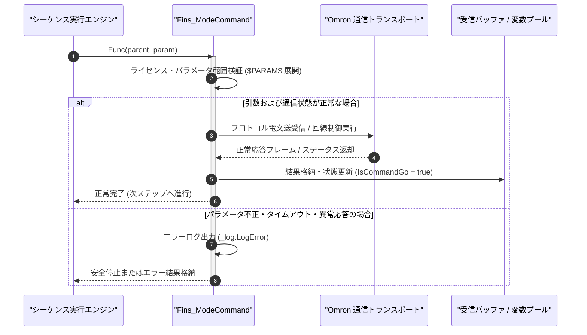

# コマンドリファレンス：Fins_Mode

## 概要

**Fins_Mode** は、OMRON FINS / HostLink 通信における物理トランスポート方式（`UDP` / `TCP` / `Serial`）および FINS ルーティングヘッダ情報（宛先ネットワーク番号 `DNA`、宛先ノード番号 `DA1`、自局ノード番号 `SA1`、宛先ユニット番号／HostLink 局番 `DA2`）を動的に設定・切り替えるコマンドです。

---

## 💡 書式・パラメータ仕様

### コマンド構文

```csv
,SEQUENCE, [ステップキー], Fins_Mode, "[Protocol]", [DestNet], [DestNode], [SrcNode], [UnitNo]
```

### パラメータ（引数）一覧

| 引数位置 | パラメータ名 | 必須/任意 | 型・制約 | 説明 |
| :--- | :--- | :---: | :--- | :--- |
| 第 1 引数 | `Protocol` | 任意 | `"UDP"`, `"TCP"`, `"Serial"`（既定: `"UDP"`） | 使用する通信トランスポート方式。 |
| 第 2 引数 | `DestNet` | 任意 | 数値（0〜127、既定: `0`） | 宛先ネットワークアドレス（`DNA`）。同一ネットワーク内は `0`。 |
| 第 3 引数 | `DestNode` | 任意 | 数値（0〜254、既定: `0`） | 宛先ノードアドレス（`DA1`）。直接接続・自動解決時は `0`、IP 末尾指定時は該当ノード番号。 |
| 第 4 引数 | `SrcNode` | 任意 | 数値（0〜254、既定: `1`） | 送信元（PC 側）ノードアドレス（`SA1`）。 |
| 第 5 引数 | `UnitNo` | 任意 | 数値（0〜254、既定: `0`） | 宛先ユニットアドレス（`DA2`、CPU ユニットは `0`）。シリアル HostLink 時は上位リンク号機番号（`00`〜`31`）としても使用されます。 |

---

## 🔄 特殊置換規約・分岐規約の適用

本コマンドの引数における特殊記法および解釈ルールです。
* **動的置換（`$`）**: 引数内で `$PARAMキー$` のように記述すると、実行時に変数プール（PARAM）の値へ動的置換されます。（適用可能な引数: 全引数対応）
* **ジャンプ先指定（`#`）**: 本コマンドはジャンプ制御を行わないため適用されません。（適用可能な引数: 非適用）
* **共通コマンド指定（`@`）**: 本コマンドは外部マクロを呼び出さないため、共通コマンド呼び出し記法は適用されません。（適用可能な引数: 非適用）
* **カンマのエスケープ**: 通信条件文字列（例: `"9600,E,7,1"`）や複数データのカンマ区切り値を単一引数として渡す場合は、必ず `"..."` と二重引用符で囲んで記述します。
* **エイリアス（別名）**: `Analysis_Fins_Mode`, `Sqn_Fins_Mode`

---

## 💡 動作例（正しい構文での記述例）

### スクリプト記述例

※COMMAND ブロック配下の子要素行（PARAM, SEQUENCE）は必ず行頭カンマから開始し、スペースインデントや行末コメント（`;`）は記述しないでください。

```csv
COMMAND, "SAMPLE_FINS_MODE", ""
; 1. FINS/UDP、DNA=0, DA1=1, SA1=10, CPUユニット(DA2=0) に設定
,SEQUENCE, 010, Fins_Mode, "UDP", 0, 1, 10, 0
,SEQUENCE, 020, Fins_Open, "192.168.250.1", "9600", "UDP"
; 2. DM0 から 4 ワード読出
,SEQUENCE, 030, Fins_ReadWord, "DM0", 4, "@RESULT_DM0", "HEX"
,SEQUENCE, 040, Fins_Close
,SEQUENCE, 050, Exit
```

### 実行時の挙動・変数変化

* **実行前の状態**: Term 通信エンジンが初期化され、必要な通信パラメータおよび変数プール（`PARAM`）が準備されている状態。
* **実行後の状態**: ステップ実行により `Fins_Mode` の通信制御・プロトコル処理が正常に遂行され、結果または回線状態が更新されます。

---

## 🔄 動作フロー（シーケンス図）



---

## 🚫 エラーハンドリング・安全設計（仕様制限）

入力データの異常や実行時エラーに対し、解析・実行エンジンが実行するセーフティ規約です。

1. **引数範囲・プロトコル書式バリデーション保護**:
   - 必須引数の欠落、デバイス表記・数値範囲の不正、または余剰引数が指定された場合は `_log.LogError` に詳細を記録し、`SetErrorAndHalt` により異常電文の送出を未然に遮断します。
2. **通信タイムアウト・異常応答・排他ドメイン保護**:
   - 相手機器の無応答タイムアウト、NAK／異常終了コード応答、または他通信ドメインとの排他競合が発生した場合は、例外クラッシュを起こさず安全にエラーハンドリングを行います。

---

## 🧪 ユニットテスト仕様

本コマンドクラス（`Fins_ModeCommand.cs`）に実装されている `RunUnitTest()` メソッドが検証するユニットテストの仕様です。

### テスト実行前提条件

* **実行トリガー**: `RunUnitTest()` メソッドの呼び出し
* **有効化条件**: システム全体の最小ログレベル（`ErrorLogger.MinimumLevel`）が `LogLevel.Test` であること（それ以外の場合は無効化ガードにより早期リターン）
* **検証結果出力**: `_log.LogTest` によるログ出力。検証失敗時は `_log.LogError`、予期せぬ例外発生時は `_log.LogCritical` で記録し、`finally` ブロックで `TransportKind` およびルーティング設定（`DefaultDestNet`, `DefaultDestNode`, `DefaultSrcNode`, `DefaultDestUnit`, `DefaultHostLinkUnitNo`）を開始前の値へ復元します。

### テストケース一覧

| No | テストカテゴリ | テスト条件（入力値） | 期待される結果（出力値） | 検証の目的 / 観点 |
| :---: | :--- | :--- | :--- | :--- |
| **1** | 正常系 | 引数 `"TCP"`, `"1"`, `"10"`, `"20"`, `"2"` の 5 引数を指定して実行 | `!param.HasError` かつ `param.IsCommandGo == true`、`TransportKind == FinsTransportKind.Tcp`、`DefaultDestNet == 1`、`DefaultDestNode == 10`、`DefaultSrcNode == 20`、`DefaultDestUnit == 2` となる | トランスポート方式および FINS ルーティングヘッダ情報（DNA/DA1/SA1/DA2）の一括反映検証 |
| **2** | 異常系 | 引数なしまたは 6 個以上の指定（`ValidateParamRange(1, 5)` 違反）、および設定更新中の例外発生 | 引数範囲外エラー出力による早期リターン、または `_log.LogCritical` 記録と `SetErrorAndHalt(-1, ex.Message)` による安全停止 | 引数個数境界ガードおよびモード変更例外時のクラッシュ防御検証 |
