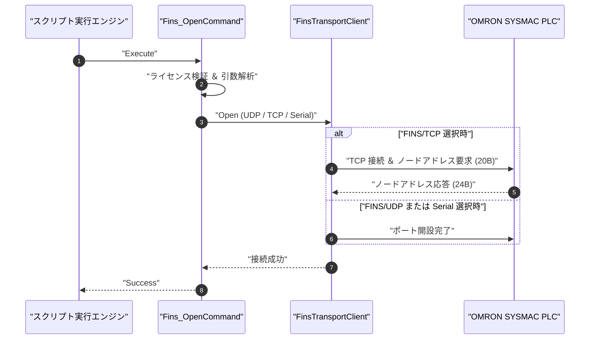

# コマンドリファレンス：Fins_Open

## 概要

**Fins_Open** は、設定値または引数で指定された接続先に基づき、オムロン（OMRON）製 PLC（SYSMAC CS / CJ / CP / NJ / NX シリーズ）との **FINS/UDP** ・ **FINS/TCP** または **シリアル HostLink（上位リンク）** 通信回線を開設するコマンドです。
実行時に Term 通信制御の排他選択モードを **OMRON FINS モード** （`TermAnalysis.Omron.dll`）へ確定させます。

---

## 💡 書式・パラメータ仕様

### コマンド構文

```csv
,SEQUENCE, [ステップキー], Fins_Open, "[Endpoint]", "[PortOrOption]", "[Protocol]"
```

※ 引数を省略した場合は、UI プロパティ設定画面（または `Fins_Mode`）の現在の設定値が自動適用されます。

### パラメータ（引数）一覧

| 引数位置 | パラメータ名 | 必須/任意 | 型・制約 | 説明 |
| :--- | :--- | :---: | :--- | :--- |
| 第 1 引数 | `Endpoint` | 任意 | 文字列（例: `"192.168.250.1"` または `"COM1"`） | 接続先 PLC の IP アドレス／ホスト名、またはシリアル COM ポート名。`"192.168.250.1:9600"` のようなポート同時指定も可能。 |
| 第 2 引数 | `PortOrOption` | 任意 | 文字列（例: `"9600"` または `"9600,E,7,2"`） | Ethernet 時はポート番号（既定: `"9600"`）、シリアル HostLink 時は通信条件文字列（既定: `"9600,E,7,2"`）。 |
| 第 3 引数 | `Protocol` | 任意 | `"UDP"`, `"TCP"`, `"Serial"`（大文字小文字不問） | 物理トランスポート方式。省略時は現在のモード設定値（既定: `"UDP"`）。 |

---

## 🔄 特殊置換規約・分岐規約の適用

本コマンドの引数における特殊記法および解釈ルールです。
* **動的置換（`$`）**: 引数内で `$PARAMキー$` のように記述すると、実行時に変数プール（PARAM）の値へ動的置換されます。（適用可能な引数: 全引数対応）
* **ジャンプ先指定（`#`）**: 本コマンドはジャンプ制御を行わないため適用されません。（適用可能な引数: 非適用）
* **共通コマンド指定（`@`）**: 本コマンドは外部マクロを呼び出さないため、共通コマンド呼び出し記法は適用されません。（適用可能な引数: 非適用）
* **カンマのエスケープ**: 通信条件文字列（例: `"9600,E,7,1"`）や複数データのカンマ区切り値を単一引数として渡す場合は、必ず `"..."` と二重引用符で囲んで記述します。
* **エイリアス（別名）**: `Analysis_Fins_Open`, `Sqn_Fins_Open`

---

## 💡 動作例（正しい構文での記述例）

### スクリプト記述例

※COMMAND ブロック配下の子要素行（PARAM, SEQUENCE）は必ず行頭カンマから開始し、スペースインデントや行末コメント（`;`）は記述しないでください。

```csv
COMMAND, "SAMPLE_FINS_OPEN", ""
; 1. OMRON FINS/UDP（IP: 192.168.250.1, Port: 9600）でオープン
,SEQUENCE, 010, Fins_Open, "192.168.250.1", "9600", "UDP"
; 2. DM100 から 2 ワード読出（10進形式）
,SEQUENCE, 020, Fins_ReadWord, "DM100", 2, "@RCV_DATA", "DEC"
; 3. 回線切断
,SEQUENCE, 030, Fins_Close
,SEQUENCE, 040, Exit
```

### 実行時の挙動・変数変化

* **実行前の状態**: Term 通信エンジンが初期化され、必要な通信パラメータおよび変数プール（`PARAM`）が準備されている状態。
* **実行後の状態**: ステップ実行により `Fins_Open` の通信制御・プロトコル処理が正常に遂行され、結果または回線状態が更新されます。

---

## 🔄 動作フロー（シーケンス図）



---

## 🚫 エラーハンドリング・安全設計（仕様制限）

入力データの異常や実行時エラーに対し、解析・実行エンジンが実行するセーフティ規約です。

1. **引数範囲・プロトコル書式バリデーション保護**:
   - 必須引数の欠落、デバイス表記・数値範囲の不正、または余剰引数が指定された場合は `_log.LogError` に詳細を記録し、`SetErrorAndHalt` により異常電文の送出を未然に遮断します。
2. **通信タイムアウト・異常応答・排他ドメイン保護**:
   - 相手機器の無応答タイムアウト、NAK／異常終了コード応答、または他通信ドメインとの排他競合が発生した場合は、例外クラッシュを起こさず安全にエラーハンドリングを行います。

---

## 🧪 ユニットテスト仕様

本コマンドクラス（`Fins_OpenCommand.cs`）に実装されている `RunUnitTest()` メソッドが検証するユニットテストの仕様です。

### テスト実行前提条件

* **実行トリガー**: `RunUnitTest()` メソッドの呼び出し
* **有効化条件**: システム全体の最小ログレベル（`ErrorLogger.MinimumLevel`）が `LogLevel.Test` であること（それ以外の場合は無効化ガードにより早期リターン）
* **検証結果出力**: `_log.LogTest` によるログ出力。検証失敗時は `_log.LogError`、予期せぬ例外発生時は `_log.LogCritical` で記録し、`finally` ブロックで `FinsTransportClient.Shared.IsSimulationMode` を開始前の状態へ復元します。

### テストケース一覧

| No | テストカテゴリ | テスト条件（入力値） | 期待される結果（出力値） | 検証の目的 / 観点 |
| :---: | :--- | :--- | :--- | :--- |
| **1** | 正常系 | `FinsTransportClient.Shared.IsSimulationMode = true` 環境下で引数 `"192.168.250.10"`, `"9600"`, `"UDP"` を指定して実行 | `!param.HasError` かつ `param.IsCommandGo == true`、`Host == "192.168.250.10"`、`Port == 9600`、`TransportKind == FinsTransportKind.Udp` となる | FINS/UDP エンドポイント設定および通信回線オープンの検証 |
| **2** | 異常系 | 引数 4 個以上の過剰指定（`ValidateParamRange(0, 3)` 違反）または実回線モードでのオープン失敗（`!client.Open()`） | 引数検証エラーによる早期リターン、または `SetErrorAndHalt(-1, failMsg)` により安全に停止する | 引数境界チェックおよび回線接続失敗時のフェイルセーフ検証 |
