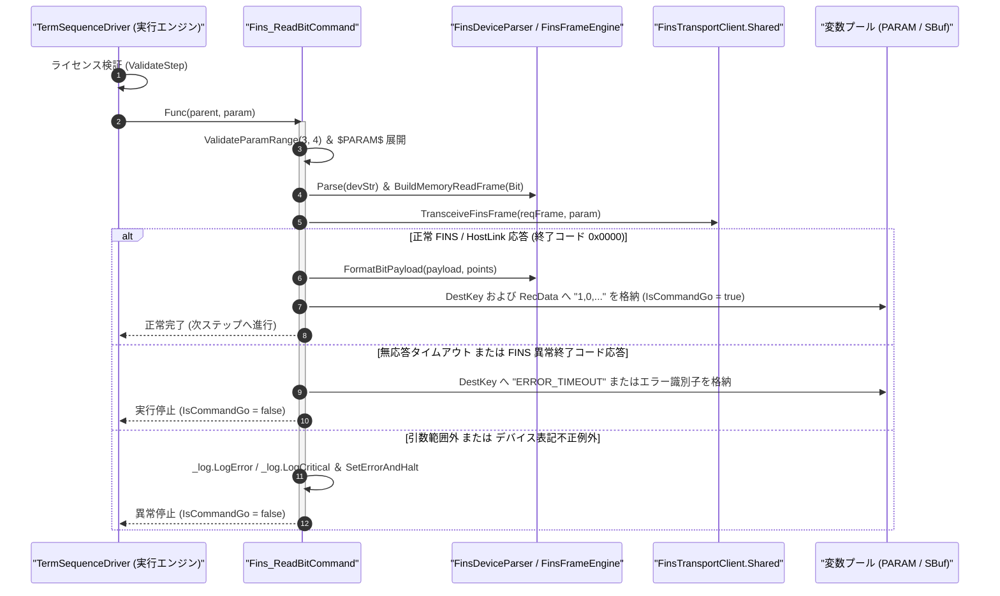

# コマンドリファレンス：Fins_ReadBit

## 概要

**Fins_ReadBit** は、OMRON FINS メモリエリア読出コマンド（ビット単位：`MRC=01`, `SRC=01`）を用いて、PLC の **ビットデバイス（CIO0.00, W10.05, H0.01, DM100.00 等）の ON/OFF 状態を一括読出** する通信制御系コマンドです。
読み出された各ビット状態は、`1`（ON）または `0`（OFF）のカンマ区切り文字列（例: `"1,0,1,0"`）として結果変数／セルへ格納されます。

---

## 💡 書式・パラメータ仕様

### コマンド構文

```csv
,SEQUENCE, [ステップキー], Fins_ReadBit, [Device], [Points], [DestKey], "[Format: DEC]"
```

### パラメータ（引数）一覧

| 引数位置 | 引数名 | 必須/任意 | 説明・制約 |
| :--- | :--- | :---: | :--- |
| 第 1 引数 | `Device` | **必須** | 読み出しを開始する先頭ビットアドレス（`<エリア><チャネル>.<00〜15>` 形式。ビット位置省略時は `.00`、対応エリア: `CIO`［接頭辞省略可］, `WR`/`W`, `HR`/`H`, `AR`/`A`, `DM`/`D`, `EM`/`E`/`E0_`〜`EC_`, `TIM`/`T`, `CNT`/`C`。例: `"CIO0.00"`, `"W20.15"`, `"DM100.05"`）。 |
| 第 2 引数 | `Points` | **必須** | 連続して読み出すビット点数（`1` 以上の整数文字列。`0` または非数値文字列が渡された場合はエラー停止せず `1` 点へフォールバックします。C# 側での上限遮断は行いませんが、FINS プロトコル上の実用推奨範囲は `1`〜`999` 点程度であり、PLC フレーム長上限を超過した場合は PLC 側から FINS 異常終了コードが返却されます）。 |
| 第 3 引数 | `DestKey` | **必須** | 取得したビット列（`"1,0,..."`）を保存するパラメータキー名（`"@"` や `"$"` を付けない素のキー名、例: `"CIO_BITS"`）。 |
| 第 4 引数 | `Format` | 任意 | 互換用の予約引数（省略時既定値: `"DEC"`）。`ParameterSpec` および `ValidateParamRange(3, 4)` により受け付けますが、ビット読出結果は常に `"1,0,..."` 形式で出力されます。 |

---

## 🔄 特殊置換規約・分岐規約の適用

本コマンドの引数における特殊記法および解釈ルールです。
* **動的置換（`$`）**: 引数内で `$PARAMキー$` のように記述すると、実行時に変数プール（PARAM）の値へ動的置換されます。（適用可能な引数: 全引数対応）
* **ジャンプ先指定（`#`）**: 本コマンドはジャンプ制御を行わないため適用されません。（適用可能な引数: 非適用）
* **共通コマンド指定（`@`）**: 本コマンドは外部マクロを呼び出さないため、共通コマンド呼び出し記法は適用されません。（適用可能な引数: 非適用）
* **カンマのエスケープ**: 引数自体にカンマを含める場合は、必ず `"..."` と二重引用符で囲んで記述します。
* **エイリアス（別名）**: `Fins_Read_Bit`, `Analysis_Fins_ReadBit`

---

## 💡 動作例（正しい構文での記述例）

### スクリプト記述例

※COMMAND ブロック配下の子要素行（PARAM, SEQUENCE）は必ず行頭カンマから開始し、スペースインデントや行末コメント（`;`）は記述しないでください。

```csv
COMMAND, "SAMPLE_FINS_READBIT", "CIO_BITS"
,PARAM, "CIO_BITS", Work, "CIOビット読出結果", ""
; 1. 接続開始
,SEQUENCE, 010, Fins_Open, "192.168.250.1", "9600", "UDP"
; 2. CIO0.00 から 4 ビット（0.00〜0.03）を一括読出し CIO_BITS へ格納
,SEQUENCE, 020, Fins_ReadBit, "CIO0.00", 4, "CIO_BITS"
; 3. 全ビット OFF ("0,0,0,0") でないか判定（全 OFF 時は #NG_PROC# へ分岐）
,SEQUENCE, 030, Judge, "NEQ", "$CIO_BITS$", "0,0,0,0", "#NG_PROC#"
,SEQUENCE, 040, Fins_Close
,SEQUENCE, 050, Exit, "$CIO_BITS$", 0
; 条件不成立時のクローズ＆異常終了経路
,SEQUENCE, #NG_PROC#, Fins_Close
,SEQUENCE, 070, Exit, "NG", -1
```

### 実行時の挙動・変数変化

* **実行前の状態**: Term 通信エンジンが初期化され、変数プール（`PARAM`）に `"CIO_BITS"` が定義されている状態。
* **実行後の状態**: ステップ `020` で FINS ビット一括読出が実行され、`"1,0,1,0"` 形式のビット列が `"CIO_BITS"` に格納されます。後続の `Judge` で全 OFF でないことが確認されるとクローズして正常終了し、全 OFF 時は `#NG_PROC#` へ分岐してクローズ後にエラー終了します（※無応答や異常終了コード時はステップ `020` で即停止します）。

---

## 🔄 動作フロー（シーケンス図）



---

## 🚫 エラーハンドリング・安全設計（仕様制限）

入力データの異常や実行時エラーに対し、解析・実行エンジンが実行するセーフティ規約です。

1. **引数範囲およびデバイス構文の検証**:
   - 引数が 2 個以下または 5 個以上の場合は `ValidateParamRange(3, 4)` により `_log.LogError` と `SetErrorAndHalt` で遮断します。未対応エリアやビット位置不正（`.16` 以上等）により `FinsDeviceParser.Parse` が例外を送出した場合は、`catch` 節で `_log.LogCritical` に記録し `SetErrorAndHalt(-1, ex.Message)` で安全停止します（`Points` が `0` または非数値の場合は `1` 点へフォールバックします）。
2. **無応答タイムアウトおよび FINS 異常終了コードの検出**:
   - 受信データが空の場合は `DestKey` に `"ERROR_TIMEOUT"` を、FCS 不一致や FINS 異常終了コード（非 `0x0000`）の場合はエラー識別文字列を格納し、`param.IsCommandGo = false` として後続ステップへの誤進行を防止します。

---

## 🧪 ユニットテスト仕様

本コマンドクラス（`Fins_ReadBitCommand.cs`）に実装されている `RunUnitTest()` メソッドが検証するユニットテストの仕様です。

### テスト実行前提条件

* **実行トリガー**: `RunUnitTest()` メソッドの呼び出し
* **有効化条件**: システム全体の最小ログレベル（`ErrorLogger.MinimumLevel`）が `LogLevel.Test` であること（それ以外の場合は無効化ガードにより早期リターン）
* **検証結果出力**: `_log.LogTest` によるログ出力。検証失敗時は `_log.LogError`、予期せぬ例外発生時は `_log.LogCritical` で記録し、`finally` ブロックで `FinsTransportClient.Shared.IsSimulationMode` を開始前の状態へ復元します。

### テストケース一覧

| No | テストカテゴリ | テスト条件（入力値） | 期待される結果（出力値） | 検証の目的 / 観点 |
| :---: | :--- | :--- | :--- | :--- |
| **1** | 正常系 | `IsSimulationMode = true` 環境下で引数 `"CIO0.02"`, `"3"`, `"BIT_RESULT"` および擬似 FINS ビット読出応答（`C0 00 02 00 01 00 00 00 00 01 01 01 00 00 01 00 01`）を与えて実行 | `!param.HasError` かつ `param.IsCommandGo == true`、格納先 `SBuf["BIT_RESULT"]` が `"1,0,1"` と一致する | ビットアドレス指定での FINS 0101 読出および `"1,0,1"` カンマ区切り格納の検証 |
| **2** | 異常系 | 引数 0 個（`new TermSequence { Name = "Fins_ReadBit" }`）で `Func(null, invalidParam)` を実行 | `ValidateParamRange(3, 4)` により拒否され、`invalidParam.HasError == true` かつ `!invalidParam.IsCommandGo` となる | 必須引数欠落時のバリデーション拒否検証 |
