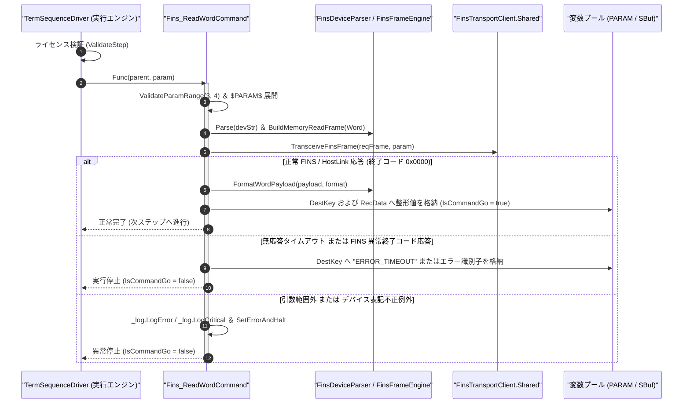

# コマンドリファレンス：Fins_ReadWord

## 概要

**Fins_ReadWord** は、OMRON FINS メモリエリア読出コマンド（ワード単位：`MRC=01`, `SRC=01`）を用いて、PLC の **チャネル／ワードデバイス（DM, CIO, WR, HR, AR, EM, TIM, CNT）を一括読出** する通信制御系コマンドです。
読み出された各ワード値（Big-Endian 16 ビット）は、指定した出力形式（10 進数 `DEC` または `0x` 付き 16 進数 `HEX`）のカンマ区切り文字列として結果変数／セルへ自動格納されます。

---

## 💡 書式・パラメータ仕様

### コマンド構文

```csv
,SEQUENCE, [ステップキー], Fins_ReadWord, [Device], [Points], [DestKey], "[Format: DEC]"
```

### パラメータ（引数）一覧

| 引数位置 | 引数名 | 必須/任意 | 説明・制約 |
| :--- | :--- | :---: | :--- |
| 第 1 引数 | `Device` | **必須** | 読み出しを開始する先頭ワードデバイス名（対応エリア: `DM`/`D`, `CIO`［接頭辞省略可］, `WR`/`W`, `HR`/`H`, `AR`/`A`, `EM`/`E`/`E0_`〜`EC_`, `TIM`/`T`, `CNT`/`C`。例: `"DM100"`, `"D100"`, `"CIO10"`, `"WR20"`, `"E0_100"`）。 |
| 第 2 引数 | `Points` | **必須** | 連続して読み出すワード（チャネル）点数（`1` 以上の整数文字列。`0` または非数値文字列が渡された場合はエラー停止せず `1` 点へフォールバックします。C# 側での上限遮断は行いませんが、FINS プロトコル上の実用推奨範囲は `1`〜`999` 点程度であり、PLC フレーム長上限を超過した場合は PLC 側から FINS 異常終了コードが返却されます）。 |
| 第 3 引数 | `DestKey` | **必須** | 取得したデータ文字列を格納するパラメータキー名（`"@"` や `"$"` を付けない素のキー名、例: `"DM200_VAL"`）。 |
| 第 4 引数 | `Format` | 任意 | 出力数値フォーマット（`"HEX"`: `0x` 付き 4 桁大文字 16 進カンマ区切り［例: `"0x1234,0x5678"`］、`"HEX"` 以外［既定 `"DEC"`］: 符号なし 16 ビット 10 進カンマ区切り［例: `"4660,22136"`］）。 |

---

## 🔄 特殊置換規約・分岐規約の適用

本コマンドの引数における特殊記法および解釈ルールです。
* **動的置換（`$`）**: 引数内で `$PARAMキー$` のように記述すると、実行時に変数プール（PARAM）の値へ動的置換されます。（適用可能な引数: 全引数対応）
* **ジャンプ先指定（`#`）**: 本コマンドはジャンプ制御を行わないため適用されません。（適用可能な引数: 非適用）
* **共通コマンド指定（`@`）**: 本コマンドは外部マクロを呼び出さないため、共通コマンド呼び出し記法は適用されません。（適用可能な引数: 非適用）
* **カンマのエスケープ**: 引数自体にカンマを含める場合は、必ず `"..."` と二重引用符で囲んで記述します。
* **エイリアス（別名）**: `Fins_Read_Word`, `Analysis_Fins_ReadWord`

---

## 💡 動作例（正しい構文での記述例）

### スクリプト記述例

※COMMAND ブロック配下の子要素行（PARAM, SEQUENCE）は必ず行頭カンマから開始し、スペースインデントや行末コメント（`;`）は記述しないでください。

```csv
COMMAND, "SAMPLE_FINS_READWORD", "DM200_VAL"
,PARAM, "DM200_VAL", Work, "DM200読出結果", ""
; 1. 接続開始
,SEQUENCE, 010, Fins_Open, "192.168.250.1", "9600", "UDP"
; 2. DM200 から 2 ワードを 16進形式で一括読出し DM200_VAL へ格納
,SEQUENCE, 020, Fins_ReadWord, "DM200", 2, "DM200_VAL", "HEX"
; 3. 全ゼロ ("0x0000,0x0000") でないか判定（全ゼロ時は #NG_PROC# へ分岐）
,SEQUENCE, 030, Judge, "NEQ", "$DM200_VAL$", "0x0000,0x0000", "#NG_PROC#"
,SEQUENCE, 040, Fins_Close
,SEQUENCE, 050, Exit, "$DM200_VAL$", 0
; 条件不成立時のクローズ＆異常終了経路
,SEQUENCE, #NG_PROC#, Fins_Close
,SEQUENCE, 070, Exit, "NG", -1
```

### 実行時の挙動・変数変化

* **実行前の状態**: Term 通信エンジンが初期化され、変数プール（`PARAM`）に `"DM200_VAL"` が定義されている状態。
* **実行後の状態**: ステップ `020` で FINS `0101` ワード読出が実行され、`"HEX"` 指定により `"0x1234,0x5678"` 形式の文字列が `"DM200_VAL"` に格納されます。後続の `Judge` で全ゼロでないことが確認されると回線を閉じて正常終了し、一致時は `#NG_PROC#` へ分岐してクローズ後にエラー終了します。

---

## 🔄 動作フロー（シーケンス図）



---

## 🚫 エラーハンドリング・安全設計（仕様制限）

入力データの異常や実行時エラーに対し、解析・実行エンジンが実行するセーフティ規約です。

1. **引数範囲およびデバイス構文の検証**:
   - 引数が 2 個以下または 5 個以上の場合は `ValidateParamRange(3, 4)` により `_log.LogError` と `SetErrorAndHalt` で遮断します。未対応エリアやアドレス範囲外により `FinsDeviceParser.Parse` が例外を送出した場合は、`catch` 節で `_log.LogCritical` に記録し `SetErrorAndHalt(-1, ex.Message)` で安全停止します（`Points` が `0` または非数値の場合は `1` 点へフォールバックします）。
2. **無応答タイムアウトおよび FINS 異常終了コードの検出**:
   - 受信データが空の場合は `DestKey` に `"ERROR_TIMEOUT"` を、FCS 不一致や FINS 異常終了コード（非 `0x0000`）の場合はエラー識別文字列を格納し、`param.IsCommandGo = false` として後続ステップへの誤進行を防止します。

---

## 🧪 ユニットテスト仕様

本コマンドクラス（`Fins_ReadWordCommand.cs`）に実装されている `RunUnitTest()` メソッドが検証するユニットテストの仕様です。

### テスト実行前提条件

* **実行トリガー**: `RunUnitTest()` メソッドの呼び出し
* **有効化条件**: システム全体の最小ログレベル（`ErrorLogger.MinimumLevel`）が `LogLevel.Test` であること（それ以外の場合は無効化ガードにより早期リターン）
* **検証結果出力**: `_log.LogTest` によるログ出力。検証失敗時は `_log.LogError`、予期せぬ例外発生時は `_log.LogCritical` で記録し、`finally` ブロックで `FinsTransportClient.Shared.IsSimulationMode` を開始前の状態へ復元します。

### テストケース一覧

| No | テストカテゴリ | テスト条件（入力値） | 期待される結果（出力値） | 検証の目的 / 観点 |
| :---: | :--- | :--- | :--- | :--- |
| **1** | 正常系 | `IsSimulationMode = true` 環境下で引数 `"D100"`, `"2"`, `"DEST_VAL"`, `"DEC"` および擬似 FINS `0101` 応答（`C0 00 02 00 01 00 00 00 00 01 01 01 00 00 00 64 00 C8`）を与えて実行 | `!param.HasError` かつ `param.IsCommandGo == true`、格納先 `SBuf["DEST_VAL"]` が `"100,200"` と一致する | FINS 0101 ワード読出要求構築・Big-Endian ペイロード解析・DEC 格納の検証 |
| **2** | 異常系 | 引数 0 個（`new TermSequence { Name = "Fins_ReadWord" }`）で `Func(null, invalidParam)` を実行 | `ValidateParamRange(3, 4)` により拒否され、`invalidParam.HasError == true` かつ `!invalidParam.IsCommandGo` となる | 必須引数欠落時のバリデーション拒否検証 |
