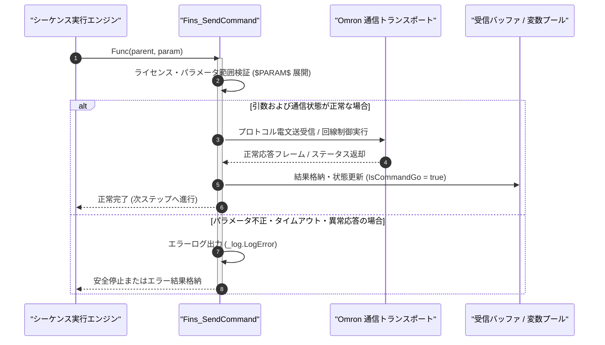

# コマンドリファレンス：Fins_Send

## 概要

**Fins_Send** は、任意の FINS コマンド PDU（16進文字列）またはシリアル HostLink コマンド（`@00...`）を指定して PLC へ直接送出する汎用送信用コマンドです。
メモリ一括読書き以外の拡張 FINS コマンド（`0501` コントローラ情報読出、`0601` ステータス読出、`0401`/`0402` 運転・停止切替、`2102` 時計書込等）や、Cモード上位リンクコマンド（`@00MM`, `@00RD...` 等）の実行に使用します。

---

## 💡 書式・パラメータ仕様

### コマンド構文

```csv
,SEQUENCE, [ステップキー], Fins_Send, "[Frame]"
```

### パラメータ（引数）一覧

| 引数位置 | パラメータ名 | 必須/任意 | 型・制約 | 説明 |
| :--- | :--- | :---: | :--- | :--- |
| 第 1 引数 | `Frame` | 必須 | 16進文字列（例: `"0501"`）または `@` 始まりの HostLink 文字列（例: `"@00MM"`） | 送信する FINS PDU（10バイト FINS ヘッダ自動付与）、完全な FINS フレーム（`800002...`）、または HostLink ASCII コマンド。 |

---

## 🔄 特殊置換規約・分岐規約の適用

本コマンドの引数における特殊記法および解釈ルールです。
* **動的置換（`$`）**: 引数内で `$PARAMキー$` のように記述すると、実行時に変数プール（PARAM）の値へ動的置換されます。（適用可能な引数: 全引数対応）
* **ジャンプ先指定（`#`）**: 本コマンドはジャンプ制御を行わないため適用されません。（適用可能な引数: 非適用）
* **共通コマンド指定（`@`）**: 本コマンドは外部マクロを呼び出さないため、共通コマンド呼び出し記法は適用されません。（適用可能な引数: 非適用）
* **カンマのエスケープ**: 通信条件文字列（例: `"9600,E,7,1"`）や複数データのカンマ区切り値を単一引数として渡す場合は、必ず `"..."` と二重引用符で囲んで記述します。
* **エイリアス（別名）**: `Fins_S`, `Analysis_Fins_Send`

---

## 💡 動作例（正しい構文での記述例）

### スクリプト記述例

※COMMAND ブロック配下の子要素行（PARAM, SEQUENCE）は必ず行頭カンマから開始し、スペースインデントや行末コメント（`;`）は記述しないでください。

```csv
COMMAND, "SAMPLE_FINS_SEND", ""
; 1. 接続開始
,SEQUENCE, 010, Fins_Open, "192.168.250.1", "9600", "UDP"
; 2. コントローラ情報読出コマンド（MRC=05, SRC=01）を送信
,SEQUENCE, 020, Fins_Send, "0501"
; 3. 応答を ASCII 文字列として受信・格納
,SEQUENCE, 030, Fins_Receive, "@PLC_MODEL", "ASCII"
; 4. 切断
,SEQUENCE, 040, Fins_Close
,SEQUENCE, 050, Exit
```

### 実行時の挙動・変数変化

* **実行前の状態**: Term 通信エンジンが初期化され、必要な通信パラメータおよび変数プール（`PARAM`）が準備されている状態。
* **実行後の状態**: ステップ実行により `Fins_Send` の通信制御・プロトコル処理が正常に遂行され、結果または回線状態が更新されます。

---

## 🔄 動作フロー（シーケンス図）



---

## 🚫 エラーハンドリング・安全設計（仕様制限）

入力データの異常や実行時エラーに対し、解析・実行エンジンが実行するセーフティ規約です。

1. **引数範囲・プロトコル書式バリデーション保護**:
   - 必須引数の欠落、デバイス表記・数値範囲の不正、または余剰引数が指定された場合は `_log.LogError` に詳細を記録し、`SetErrorAndHalt` により異常電文の送出を未然に遮断します。
2. **通信タイムアウト・異常応答・排他ドメイン保護**:
   - 相手機器の無応答タイムアウト、NAK／異常終了コード応答、または他通信ドメインとの排他競合が発生した場合は、例外クラッシュを起こさず安全にエラーハンドリングを行います。

---

## 🧪 ユニットテスト仕様

本コマンドクラス（`Fins_SendCommand.cs`）に実装されている `RunUnitTest()` メソッドが検証するユニットテストの仕様です。

### テスト実行前提条件

* **実行トリガー**: `RunUnitTest()` メソッドの呼び出し
* **有効化条件**: システム全体の最小ログレベル（`ErrorLogger.MinimumLevel`）が `LogLevel.Test` であること（それ以外の場合は無効化ガードにより早期リターン）
* **検証結果出力**: `_log.LogTest` によるログ出力。検証失敗時は `_log.LogError`、予期せぬ例外発生時は `_log.LogCritical` で記録し、`finally` ブロックで `FinsTransportClient.Shared.IsSimulationMode` および `TransportKind` を開始前の状態へ復元します。

### テストケース一覧

| No | テストカテゴリ | テスト条件（入力値） | 期待される結果（出力値） | 検証の目的 / 観点 |
| :---: | :--- | :--- | :--- | :--- |
| **1** | 正常系 | `IsSimulationMode = true`・`FinsTransportKind.Udp` 環境下で短縮 FINS PDU `"0501"`（形名読出）を指定して実行 | `!param.HasError` かつ `param.IsCommandGo == true`、`param.SndData` が `"800002"` で始まり `"0501"` で終わる 10 バイトヘッダ補完済みフレームとなる | 短縮 FINS PDU への 10 バイト FINS ヘッダ自動補完および送出処理の検証 |
| **2** | 正常系 | シリアル上位リンクコマンド `"@00MM"` を指定して実行 | `!paramHl.HasError` かつ `paramHl.IsCommandGo == true`、`paramHl.SndData == "@00MM40*"` となる | HostLink ASCII コマンドに対する FCS（水平パリティ）およびターミネータ自動付与の検証 |
| **3** | 異常系 | 必須引数 `Frame` 欠落・引数範囲外（`ValidateParamRange(1, 3)` 違反）、または不正な 16 進文字列による変換例外 | 引数検証エラーによる早期リターン、または `_log.LogCritical` 記録と `SetErrorAndHalt(-1, ex.Message)` による安全停止 | 引数境界チェックおよび不正フレーム入力時のクラッシュ防御検証 |
