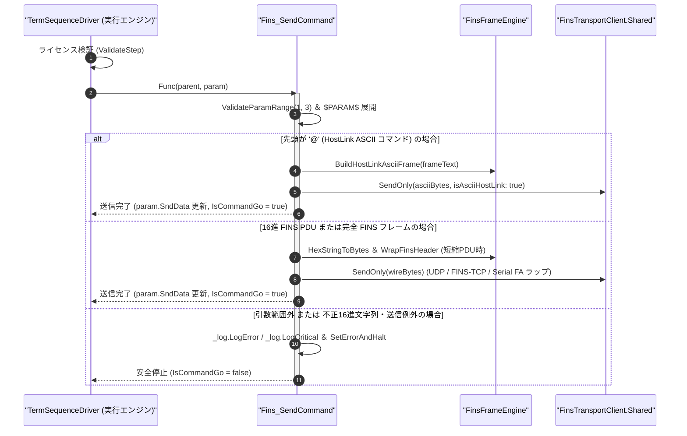

# コマンドリファレンス：Fins_Send

## 概要

**Fins_Send** は、任意の FINS コマンド PDU（16 進文字列）またはシリアル HostLink コマンド（`@00...`）を指定して PLC へ直接送出する汎用送信用コマンドです。
メモリ一括読書き以外の拡張 FINS コマンド（`0501` コントローラ情報読出、`0601` ステータス読出、`0401`/`0402` 運転・停止切替等）や、C モード上位リンクコマンド（`@00MM`, `@00RD...` 等）の実行に使用します。

---

## 💡 書式・パラメータ仕様

### コマンド構文

```csv
,SEQUENCE, [ステップキー], Fins_Send, [Frame], "[Reserved2]", "[Reserved3]"
```

### パラメータ（引数）一覧

| 引数位置 | 引数名 | 必須/任意 | 説明・制約 |
| :--- | :--- | :---: | :--- |
| 第 1 引数 | `Frame` | **必須** | 送信する FINS PDU（例: `"0501"`。先頭バイトが `0x80`/`0x81` かつ 12 バイト以上の場合はそのまま採用し、それ以外は 10 バイト FINS ヘッダを自動付与）、または `@` 始まりの HostLink ASCII コマンド（例: `"@00MM"`。FCS とターミネータ `*\r` を自動付与）。`Serial` モードで 16 進 FINS PDU を指定した場合は HostLink `FA` コマンドへ自動カプセル化されます。 |
| 第 2〜3 引数 | `Reserved2`, `Reserved3` | 任意 | 互換用の予備引数（`ValidateParamRange(1, 3)` により最大 3 引数まで許容されますが、第 2・第 3 引数の値は参照されません）。 |

---

## 🔄 特殊置換規約・分岐規約の適用

本コマンドの引数における特殊記法および解釈ルールです。
* **動的置換（`$`）**: 引数内で `$PARAMキー$` のように記述すると、実行時に変数プール（PARAM）の値へ動的置換されます。（適用可能な引数: 全引数対応）
* **ジャンプ先指定（`#`）**: 本コマンドはジャンプ制御を行わないため適用されません。（適用可能な引数: 非適用）
* **共通コマンド指定（`@`）**: 本コマンドは外部マクロを呼び出さないため、共通コマンド呼び出し記法は適用されません（※第 1 引数先頭の `@` は HostLink ASCII ヘッダ文字としてそのまま解釈されます）。（適用可能な引数: 非適用）
* **カンマのエスケープ**: 引数自体にカンマを含める場合は、必ず `"..."` と二重引用符で囲んで記述します。
* **エイリアス（別名）**: `Fins_S`, `Analysis_Fins_Send`

---

## 💡 動作例（正しい構文での記述例）

### スクリプト記述例

※COMMAND ブロック配下の子要素行（PARAM, SEQUENCE）は必ず行頭カンマから開始し、スペースインデントや行末コメント（`;`）は記述しないでください。

```csv
COMMAND, "SAMPLE_FINS_SEND", "PLC_MODEL"
,PARAM, "PLC_MODEL", Work, "PLC形名文字列", ""
; 1. 接続開始
,SEQUENCE, 010, Fins_Open, "192.168.250.1", "9600", "UDP"
; 2. コントローラ情報読出コマンド（MRC=05, SRC=01）を送信
,SEQUENCE, 020, Fins_Send, "0501"
; 3. 応答を ASCII 文字列として受信し PLC_MODEL へ格納
,SEQUENCE, 030, Fins_Receive, "PLC_MODEL", "ASCII"
; 4. 取得形名が空文字でないか判定（空の場合は #NG_PROC# へ分岐）
,SEQUENCE, 040, Judge, "NEQ", "$PLC_MODEL$", "", "#NG_PROC#"
,SEQUENCE, 050, Fins_Close
,SEQUENCE, 060, Exit, "$PLC_MODEL$", 0
; 条件不成立時のクローズ＆異常終了経路
,SEQUENCE, #NG_PROC#, Fins_Close
,SEQUENCE, 080, Exit, "NG", -1
```

### 実行時の挙動・変数変化

* **実行前の状態**: Term 通信エンジンが初期化され、変数プール（`PARAM`）に `"PLC_MODEL"` が定義されている状態。
* **実行後の状態**: `Fins_Send` により 10 バイト FINS ヘッダが自動補完された `0501` 要求電文が送信されて `param.SndData` に記録され、続く `Fins_Receive` で抽出された形名文字列が `"PLC_MODEL"` に格納された後、`Judge` で判定されて回線をクローズします。

---

## 🔄 動作フロー（シーケンス図）



---

## 🚫 エラーハンドリング・安全設計（仕様制限）

入力データの異常や実行時エラーに対し、解析・実行エンジンが実行するセーフティ規約です。

1. **引数範囲バリデーション保護**:
   - 必須引数 `Frame` が欠落している場合（0 個）または 4 個以上の引数が指定された場合は、`ValidateParamRange(1, 3)` により `_log.LogError` に詳細を記録し、`SetErrorAndHalt` で送信前に遮断します。
2. **不正 16 進文字列および送信例外の防御**:
   - 本コマンドは送信専用であり、`@` で始まらない非 16 進文字列が指定されて `HexStringToBytes` が例外を送出した場合や、回線未オープン・通信切断により `SendOnly` が失敗した場合は、`catch` 節で `_log.LogCritical` に記録し `SetErrorAndHalt(-1, ex.Message)` で安全停止します。

---

## 🧪 ユニットテスト仕様

本コマンドクラス（`Fins_SendCommand.cs`）に実装されている `RunUnitTest()` メソッドが検証するユニットテストの仕様です。

### テスト実行前提条件

* **実行トリガー**: `RunUnitTest()` メソッドの呼び出し
* **有効化条件**: システム全体の最小ログレベル（`ErrorLogger.MinimumLevel`）が `LogLevel.Test` であること（それ以外の場合は無効化ガードにより早期リターン）
* **検証結果出力**: `_log.LogTest` によるログ出力。検証失敗時は `_log.LogError`、予期せぬ例外発生時は `_log.LogCritical` で記録し、`finally` ブロックで `FinsTransportClient.Shared.IsSimulationMode` および `TransportKind` を開始前の状態へ復元します。

### テストケース一覧

| No | テストカテゴリ | テスト条件（入力値） | 期待される結果（出力値） | 検証の目的 / 観点 |
| :---: | :--- | :--- | :--- | :--- |
| **1** | 正常系 | `IsSimulationMode = true`・`FinsTransportKind.Udp` 環境下で短縮 FINS PDU `"0501"`（形名読出）を指定して実行 | `!param.HasError` かつ `param.IsCommandGo == true`、`param.SndData` が `"800002"` で始まり `"0501"` で終わる 10 バイトヘッダ補完済みフレームとなる | 短縮 FINS PDU への 10 バイト FINS ヘッダ自動補完および送出処理の検証 |
| **2** | 正常系 | シリアル上位リンクコマンド `"@00MM"` を指定して実行 | `!paramHl.HasError` かつ `paramHl.IsCommandGo == true`、`paramHl.SndData == "@00MM40*"` となる | HostLink ASCII コマンドに対する FCS（水平パリティ）およびターミネータ自動付与の検証 |
| **3** | 異常系 | 引数 0 個（`new TermSequence { Name = "Fins_Send" }`）で `Func(null, invalidParam)` を実行 | `ValidateParamRange(1, 3)` により拒否され、`invalidParam.HasError == true` かつ `!invalidParam.IsCommandGo` となる | 必須引数 `Frame` 欠落時のバリデーション拒否検証 |
