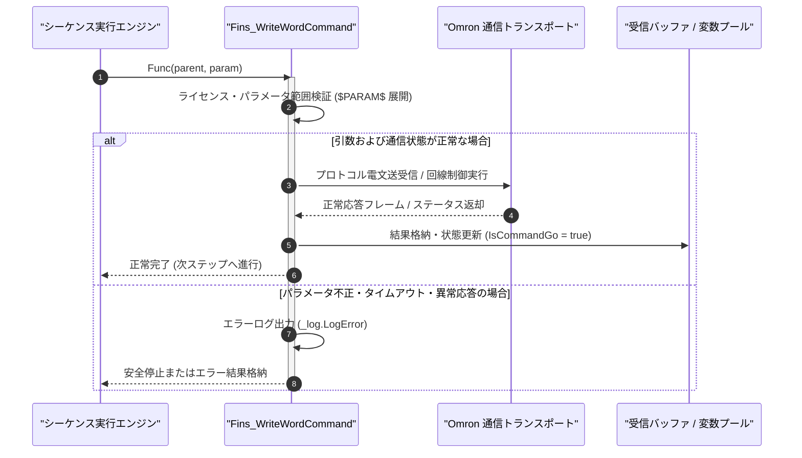

# コマンドリファレンス：Fins_WriteWord

## 概要

**Fins_WriteWord** は、OMRON FINS メモリエリア書込コマンド（`MRC=01`, `SRC=02`）を用いて、PLC の **チャネル／ワードデバイス（DM, CIO, WR, HR, AR, EM 等）へ一括書込** を行うコマンドです。
書き込み完了後、PLC からの FINS 応答終了コード（正常: `0x0000`）を自動検証します。

---

## 💡 書式・パラメータ仕様

### コマンド構文

```csv
,SEQUENCE, [ステップキー], Fins_WriteWord, "[Device]", "[Values]"
```

### パラメータ（引数）一覧

| 引数位置 | パラメータ名 | 必須/任意 | 型・制約 | 説明 |
| :--- | :--- | :---: | :--- | :--- |
| 第 1 引数 | `Device` | 必須 | 文字列（例: `"DM100"`, `"CIO10"`, `"WR0"`, `"HR10"`） | 書き込みを開始する先頭ワードデバイス名。 |
| 第 2 引数 | `Values` | 必須 | 文字列（例: `"100, 200"` または `"0x1234, 0x5678"`） | 書き込む 16 ビット整数列（カンマまたは空白区切り）。要素数から書込点数が自動算出され、Big-Endian バイト列へ変換されます。 |

---

## 🔄 特殊置換規約・分岐規約の適用

本コマンドの引数における特殊記法および解釈ルールです。
* **動的置換（`$`）**: 引数内で `$PARAMキー$` のように記述すると、実行時に変数プール（PARAM）の値へ動的置換されます。（適用可能な引数: 全引数対応）
* **ジャンプ先指定（`#`）**: 本コマンドはジャンプ制御を行わないため適用されません。（適用可能な引数: 非適用）
* **共通コマンド指定（`@`）**: 本コマンドは外部マクロを呼び出さないため、共通コマンド呼び出し記法は適用されません。（適用可能な引数: 非適用）
* **カンマのエスケープ**: 通信条件文字列（例: `"9600,E,7,1"`）や複数データのカンマ区切り値を単一引数として渡す場合は、必ず `"..."` と二重引用符で囲んで記述します。
* **エイリアス（別名）**: `Fins_Write_Word`, `Analysis_Fins_WriteWord`

---

## 💡 動作例（正しい構文での記述例）

### スクリプト記述例

※COMMAND ブロック配下の子要素行（PARAM, SEQUENCE）は必ず行頭カンマから開始し、スペースインデントや行末コメント（`;`）は記述しないでください。

```csv
COMMAND, "SAMPLE_FINS_WRITEWORD", ""
; 1. 接続開始
,SEQUENCE, 010, Fins_Open, "192.168.250.1", "9600", "UDP"
; 2. DM101 に 0x0001、DM102 に 0x00FF を一括書込（2ワード自動算出）
,SEQUENCE, 020, Fins_WriteWord, "DM101", "0x0001, 0x00FF"
; 3. 切断
,SEQUENCE, 030, Fins_Close
,SEQUENCE, 040, Exit
```

### 実行時の挙動・変数変化

* **実行前の状態**: Term 通信エンジンが初期化され、必要な通信パラメータおよび変数プール（`PARAM`）が準備されている状態。
* **実行後の状態**: ステップ実行により `Fins_WriteWord` の通信制御・プロトコル処理が正常に遂行され、結果または回線状態が更新されます。

---

## 🔄 動作フロー（シーケンス図）



---

## 🚫 エラーハンドリング・安全設計（仕様制限）

入力データの異常や実行時エラーに対し、解析・実行エンジンが実行するセーフティ規約です。

1. **引数範囲・プロトコル書式バリデーション保護**:
   - 必須引数の欠落、デバイス表記・数値範囲の不正、または余剰引数が指定された場合は `_log.LogError` に詳細を記録し、`SetErrorAndHalt` により異常電文の送出を未然に遮断します。
2. **通信タイムアウト・異常応答・排他ドメイン保護**:
   - 相手機器の無応答タイムアウト、NAK／異常終了コード応答、または他通信ドメインとの排他競合が発生した場合は、例外クラッシュを起こさず安全にエラーハンドリングを行います。

---

## 🧪 ユニットテスト仕様

本コマンドクラス（`Fins_WriteWordCommand.cs`）に実装されている `RunUnitTest()` メソッドが検証するユニットテストの仕様です。

### テスト実行前提条件

* **実行トリガー**: `RunUnitTest()` メソッドの呼び出し
* **有効化条件**: システム全体の最小ログレベル（`ErrorLogger.MinimumLevel`）が `LogLevel.Test` であること（それ以外の場合は無効化ガードにより早期リターン）
* **検証結果出力**: `_log.LogTest` によるログ出力。検証失敗時は `_log.LogError`、予期せぬ例外発生時は `_log.LogCritical` で記録し、`finally` ブロックで `FinsTransportClient.Shared.IsSimulationMode` を開始前の状態へ復元します。

### テストケース一覧

| No | テストカテゴリ | テスト条件（入力値） | 期待される結果（出力値） | 検証の目的 / 観点 |
| :---: | :--- | :--- | :--- | :--- |
| **1** | 正常系 | `IsSimulationMode = true` 環境下で引数 `"D200"`, `"100,0x00FF"` および擬似 FINS `0102` 正常応答（`C0 00 02 00 01 00 00 00 00 01 01 02 00 00`）を与えて実行 | `!param.HasError` かつ `param.IsCommandGo == true` でワード一括書込が正常完了する | 10 進／16 進混在ワード値のパース・FINS 0102 書込フレーム構築・正常終了コード検証 |
| **2** | 異常系 | 引数不足・過剰（`ValidateParamRange(2, 3)` 違反）、応答タイムアウト（空応答）、または FINS 異常終了コード応答 | `SetErrorAndHalt(-1, ...)`（または引数検証エラー）によりエラーを記録して安全に停止する | 引数境界検証および書込タイムアウト・PLC 異常応答時のフェイルセーフ検証 |
