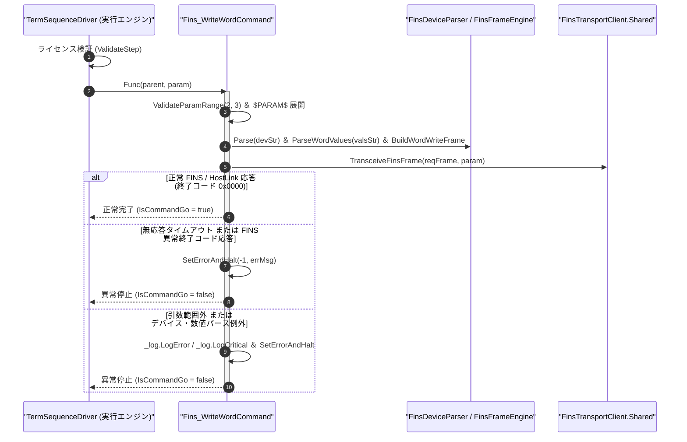

# コマンドリファレンス：Fins_WriteWord

## 概要

**Fins_WriteWord** は、OMRON FINS メモリエリア書込コマンド（ワード単位：`MRC=01`, `SRC=02`）を用いて、PLC の **チャネル／ワードデバイス（DM, CIO, WR, HR, AR, EM, TIM, CNT）へ一括書込** を行う通信制御系コマンドです。
書き込み完了後、PLC からの FINS／HostLink 応答終了コード（正常: `0x0000`）を検証します。

---

## 💡 書式・パラメータ仕様

### コマンド構文

```csv
,SEQUENCE, [ステップキー], Fins_WriteWord, [Device], [Values], "[Reserved]"
```

### パラメータ（引数）一覧

| 引数位置 | 引数名 | 必須/任意 | 説明・制約 |
| :--- | :--- | :---: | :--- |
| 第 1 引数 | `Device` | **必須** | 書き込みを開始する先頭ワードデバイス名（対応エリア: `DM`/`D`, `CIO`［接頭辞省略可］, `WR`/`W`, `HR`/`H`, `AR`/`A`, `EM`/`E`/`E0_`〜`EC_`, `TIM`/`T`, `CNT`/`C`。例: `"DM100"`, `"D100"`, `"CIO10"`, `"WR0"`, `"E0_100"`）。 |
| 第 2 引数 | `Values` | **必須** | 書き込む 16 ビット整数列（10 進符号なし／符号付き整数または `0x` 付き 16 進数、カンマまたは空白区切り。例: `"100, 200"` または `"0x1234, 0x5678"`）。要素数から書込点数が自動算出され、Big-Endian バイト列へ変換されます。 |
| 第 3 引数 | `Reserved` | 任意 | 互換用の予備引数（`ValidateParamRange(2, 3)` により 3 引数まで許容されますが、指定された値は参照されません）。 |

---

## 🔄 特殊置換規約・分岐規約の適用

本コマンドの引数における特殊記法および解釈ルールです。
* **動的置換（`$`）**: 引数内で `$PARAMキー$` のように記述すると、実行時に変数プール（PARAM）の値へ動的置換されます。（適用可能な引数: 全引数対応）
* **ジャンプ先指定（`#`）**: 本コマンドはジャンプ制御を行わないため適用されません。（適用可能な引数: 非適用）
* **共通コマンド指定（`@`）**: 本コマンドは外部マクロを呼び出さないため、共通コマンド呼び出し記法は適用されません。（適用可能な引数: 非適用）
* **カンマのエスケープ**: 複数データのカンマ区切り値（例: `"0x0001, 0x00FF"`）を単一引数として渡す場合は、必ず `"..."` と二重引用符で囲んで記述します。
* **エイリアス（別名）**: `Fins_Write_Word`, `Analysis_Fins_WriteWord`

---

## 💡 動作例（正しい構文での記述例）

### スクリプト記述例

※COMMAND ブロック配下の子要素行（PARAM, SEQUENCE）は必ず行頭カンマから開始し、スペースインデントや行末コメント（`;`）は記述しないでください。

```csv
COMMAND, "SAMPLE_FINS_WRITEWORD", ""
; 1. 接続開始
,SEQUENCE, 010, Fins_Open, "192.168.250.1", "9600", "UDP"
; 2. DM101 に 0x0001、DM102 に 0x00FF を一括書込（2ワード自動算出）
,SEQUENCE, 020, Fins_WriteWord, "DM101", "0x0001, 0x00FF"
; 3. 切断
,SEQUENCE, 030, Fins_Close
,SEQUENCE, 040, Exit
```

### 実行時の挙動・変数変化

* **実行前の状態**: `Fins_Open` により OMRON PLC（`192.168.250.1:9600`, UDP）との通信回線が開設されている状態。
* **実行後の状態**: ステップ `020` で FINS メモリエリア書込（`MRC=01`, `SRC=02`、ワード単位 2 点、Big-Endian `00 01 00 FF`）フレームが送受信され、終了コード `0x0000` が確認されると `param.IsCommandGo = true` となってステップ `030` の `Fins_Close` へ進みます。

---

## 🔄 動作フロー（シーケンス図）



---

## 🚫 エラーハンドリング・安全設計（仕様制限）

入力データの異常や実行時エラーに対し、解析・実行エンジンが実行するセーフティ規約です。

1. **引数範囲およびデバイス・数値構文の検証**:
   - 引数が 1 個以下または 4 個以上の場合は `ValidateParamRange(2, 3)` により `_log.LogError` と `SetErrorAndHalt` で遮断します。未対応エリアや 16 ビット整数範囲外の数値指定により `FinsDeviceParser.Parse` / `ParseWordValues` が例外を送出した場合は、`catch` 節で `_log.LogCritical` に記録し `SetErrorAndHalt(-1, ex.Message)` で安全停止します。
2. **書込応答タイムアウトおよび FINS 異常終了コード時の停止**:
   - 受信データが空（タイムアウト）の場合、または PLC が非 `0x0000` の FINS 異常終了コードや不正フレームを返した場合は、`SetErrorAndHalt(-1, ...)` を呼び出してシーケンスを即座に安全停止します。

---

## 🧪 ユニットテスト仕様

本コマンドクラス（`Fins_WriteWordCommand.cs`）に実装されている `RunUnitTest()` メソッドが検証するユニットテストの仕様です。

### テスト実行前提条件

* **実行トリガー**: `RunUnitTest()` メソッドの呼び出し
* **有効化条件**: システム全体の最小ログレベル（`ErrorLogger.MinimumLevel`）が `LogLevel.Test` であること（それ以外の場合は無効化ガードにより早期リターン）
* **検証結果出力**: `_log.LogTest` によるログ出力。検証失敗時は `_log.LogError`、予期せぬ例外発生時は `_log.LogCritical` で記録し、`finally` ブロックで `FinsTransportClient.Shared.IsSimulationMode` を開始前の状態へ復元します。

### テストケース一覧

| No | テストカテゴリ | テスト条件（入力値） | 期待される結果（出力値） | 検証の目的 / 観点 |
| :---: | :--- | :--- | :--- | :--- |
| **1** | 正常系 | `IsSimulationMode = true` 環境下で引数 `"D200"`, `"100,0x00FF"` および擬似 FINS `0102` 正常応答（`C0 00 02 00 01 00 00 00 00 01 01 02 00 00`）を与えて実行 | `!param.HasError` かつ `param.IsCommandGo == true` でワード一括書込が正常完了する | 10 進／16 進混在ワード値のパース・FINS 0102 書込フレーム構築・正常終了コード検証 |
| **2** | 異常系 | 引数 0 個（`new TermSequence { Name = "Fins_WriteWord" }`）で `Func(null, invalidParam)` を実行 | `ValidateParamRange(2, 3)` により拒否され、`invalidParam.HasError == true` かつ `!invalidParam.IsCommandGo` となる | 必須引数欠落時のバリデーション拒否検証 |
