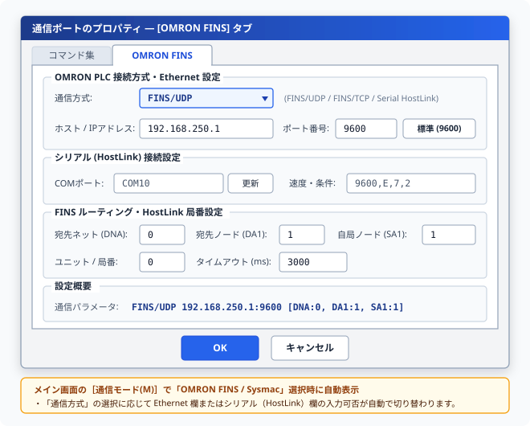
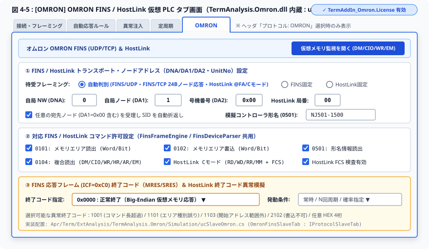

# Omron（オムロン FINS / Sysmac・HostLink）アドイン取扱説明書

👉 [← TermAddIn_Omron 製品トップに戻る](../README.md)  
👉 [← プロパティ設定画面取扱説明書（共通）](../プロパティ設定画面取扱説明書.Md) ／ [← TermEmulator 操作説明書（共通）](https://github.com/Monaca-App/TermEmulator/blob/main/Manual/TermEmulator操作説明書.Md) ／ [← マクロスクリプト取扱説明書（共通）](../マクロスクリプト取扱説明書.Md)

---

本書は、**TermAddIn_Omron**（`TermAnalysis.Omron.dll`：オムロン FINS/UDP・FINS/TCP・シリアル HostLink 通信エクステンション）の **取扱説明書 兼 機能解説書** です。FINS / HostLink の基礎仕組み、プロパティ設定画面の **「OMRON FINS」タブ**、**TermEmulator の `[OMRON]` 仮想スレーブタブ**、および全 9 コマンドのリファレンスを 1 冊にまとめています。

* **必須拡張ライセンス**: **`TermAddIn_Omron.License`** （組み込み先: `TermAnalysis.Omron.dll`、`TermEmulator` と相互共用）


### 関連する公式規格・メーカー仕様書（外部リンク）
* [オムロン制御機器 公式サイト（ダウンロードセンタ・マニュアル）](https://www.fa.omron.co.jp/) — サイト内のダウンロードセンタより以下の公式マニュアルを参照できます（ダウンロードには無料の I-Web メンバーズ登録が必要）。
  * 『CS / CJ / CP / NSJ シリーズ 通信コマンド リファレンスマニュアル』（カタログ番号: `SBCA-304` 等）［FINS コマンド体系・エリアコード・`MRES`/`SRES` 終了コード・HostLink C モード仕様］
  * 各 SYSMAC シリーズ（NJ / NX / CJ / CP）の『ユーザーズマニュアル（通信編）』
---

## 目次

- [1. 機能概要と基礎知識（はじめての方へ）](#1-機能概要と基礎知識はじめての方へ)
- [2. プロパティ設定画面：「OMRON FINS」タブの詳細](#2-プロパティ設定画面omron-finsタブの詳細)
- [3. TermEmulator 仮想スレーブ設定：「[OMRON]」タブの詳細](#3-termemulator-仮想スレーブ設定omronタブの詳細)
- [4. マクロコマンド一覧（全 9 コマンド）](#4-マクロコマンド一覧全-9-コマンド)

---

## 1. 機能概要と基礎知識（はじめての方へ）

### 対応する機能の概要
**Omron（オムロン FINS / Sysmac・HostLink）** アドインは、オムロン製 PLC（SYSMAC NJ / NX / CJ / CS / CP シリーズ等）に対して、**FINS/UDP・FINS/TCP（LAN）** および **シリアル HostLink（Sysmac Way / RS-232C）** の 3 方式すべてに対応し、`DM`, `EM`（バンク `E0_`〜`EC_` 対応）, `CIO`, `WR`, `HR`, `AR`, `TIM`/`CNT` のワード・ビット一括読み書きや任意 FINS/HostLink 電文送受信を行う通信機能です。

### 機能の実現方法
* **FINS ヘッダ・TCP ハンドシェイク・FCS の自動処理**: FINS 10 バイトヘッダ（`ICF`/`DNA`/`DA1`/`SA1`/`SID`）の自動付与、FINS/TCP 接続時の 20 バイトノードアドレス交渉ハンドシェイク、シリアル HostLink の `@` フレームおよび FCS（排他的論理和チェック）計算をすべてアドイン内部で自動完結します。
* **通信方式の透過切替**: `Fins_Mode` / プロパティ画面で `UDP` / `TCP` / `Serial` を切り替えるだけで、後ろに続く `Fins_ReadWord` / `Fins_WriteWord` / `Fins_ReadBit` / `Fins_WriteBit` のマクロ手順はそのまま共通利用できます。
* **仮想 OMRON PLC 連携**: `TermEmulator` の `[OMRON]` タブで「任意宛先受理」や終了コード（`MRES`/`SRES`）異常応答を模擬し、実機なしで FINS 通信を事前テストできます。

### このアドインを選択することの利点
* **有償ミドルウェア（FinsGateway / CX-Compolet 等）不要**: オムロン専用の通信ランタイムを導入・設定する手間やコストをかけず、標準 Windows 環境と Excel だけで直接 PLC と通信できます。
* **新旧オムロン設備を 1 アドインで統一管理**: 最新の NJ/NX シリーズ（FINS/TCP・UDP）から既存の CJ/CP/旧シリアル機（HostLink）まで 1 つのアドインと共通コマンドで扱えます。
* **設定概要プレビューによるルーティングミス防止**: 誤設定が生じやすい `DNA` / `DA1` / `SA1` の組み合わせをプロパティ画面下部に要約表示し、接続前に妥当性を目視確認できます。

### 3 つの通信方式の違い（どれを選ぶべきか）
| 通信方式 | 使うケーブル | 特徴と選び方 |
| :--- | :--- | :--- |
| **`FINS/UDP`** | LAN ケーブル | オムロン PLC の LAN 通信で最も一般的（標準ポート **`9600`**）。軽量・高速で、多くの現場で標準利用されます。 |
| **`FINS/TCP`** | LAN ケーブル | 接続確立の手順（ノードアドレス自動割当）を伴う TCP 版。ネットワーク越しの通信や、PLC 側で FINS/TCP が指定されている場合に使います。 |
| **`Serial (HostLink)`** | RS-232C ケーブル | Sysmac Way（上位リンク）とも呼ばれるシリアル接続方式。LAN ポートがない旧型機やシリアルボード経由で接続するときに選びます。 |

### 設定の妥当性を判断するための主要用語と確認項目（`DNA` / `DA1` / `SA1` とは？）
オムロン FINS 設定で初見で判断に迷いやすいのが **「FINS ルーティング（3 つの英字記号）」** です。宛先（PLC 側）と送信元（PC 側）のアドレス対応関係として理解すると整理しやすくなります。

| 設定記号 | 正式名称・意味 | 設定値の決め方と目安 |
| :--- | :--- | :--- |
| **`DNA`** | 宛先ネットワーク番号（`0`〜`127`） | 相手 PLC が属するネットワーク番号。パソコンと PLC が同じ LAN に直結されている場合は **`0`** で固定です。 |
| **`DA1`** | 宛先ノード番号（`0`〜`254`） | **相手 PLC のノード識別番号**。通常は **相手 PLC の IP アドレスの一番右の数字** と一致します（例: IP が `192.168.250.1` なら `DA1 = 1`）。 |
| **`SA1`** | 送信元ノード番号（`0`〜`254`） | **送信元 PC のノード識別番号**。通常は **自分のパソコンの IP アドレスの一番右の数字** を入れます（例: PC の IP が `192.168.250.100` なら `SA1 = 100`）。`DA1` と同じ番号にはできません。 |
| **シリアル条件（HostLink）** | RS-232C 接続時の基本ルール | オムロン HostLink の出荷時標準は **`9600 bps / データ 7 bit / パリティ Even / ストップ 2 bit`**（`9600,E,7,2`）です。 |

### 通信の仕組み解説（FINS / HostLink 構造と代表的なトラブル事例・対処法）
FINS では、宛先・送信元を示すヘッダ部（10 バイト）に、操作内容を示すコマンド部（`0101` 読出 / `0102` 書込）を付加して送信します。

```text
[FINS/UDP]      [10B FINSヘッダ (ICF/DNA/DA1/DA2/SNA/SA1/SA2/SID)] + [コマンド 0101/0102 + エリア・番地]
[FINS/TCP]      初回に 20B ノード交渉 ➔ 以降 ["FINS" 4B + 長さ 4B + Cmd 4B + Err 4B] + [FINSフレーム]
[HostLink]      "@" + [局番 2桁] + [コマンド (FA... / RD / WD)] + [FCS 2桁] + "*" + [CR]
```

* **事例①：FINS/UDP で応答が返らない** ➔ 最も多い原因は **`DA1`（PLC 側ノード番号）と `SA1`（PC 側ノード番号）の誤りまたは重複** です。IP アドレスの末尾数字と一致しているか、`DA1 != SA1` になっているか確認してください。
* **事例②：終了コード（`MRES`/`SRES`）が `0000` 以外になる** ➔ `1101` はエリア種別誤り、`1103` は開始アドレス範囲外、`2102` は書込保護エリアへの書込禁止を示します。
* **事例③：HostLink で文字化け・無応答** ➔ オムロン標準はストップビット **`2`**（`9600,E,7,2`）であり、一般的な `1` とは異なる点に注意してください。

---

## 2. プロパティ設定画面：「OMRON FINS」タブの詳細



メイン画面で **`OMRON FINS / Sysmac`** モードを選択しているときに表示され、[`Fins_Open`](./Fins_Open.Md) 等の条件を設定します（`OMRON_FINS` セクションへ保存）。

| 項目名 | 設定値・範囲（既定値） | 詳しい意味と設定のポイント |
| :--- | :--- | :--- |
| **`通信方式`** | `FINS/UDP`（既定） / `FINS/TCP` / `Serial (HostLink)` | 接続形態に合わせて選択します。選択に応じて Ethernet 欄またはシリアル欄の必要な入力項目が有効になります。 |
| **`Ethernet 設定`** | IP アドレス（既定 `192.168.250.1`）・ポート `9600`（`[ 標準 (9600) ]` ボタン付） | FINS/UDP または FINS/TCP 接続時の宛先を指定します。 |
| **`シリアル (HostLink) 設定`** | COM ポート（`[ 更新 ]` ボタン付）・条件（既定 `9600,E,7,2` 等） | HostLink（Sysmac Way）シリアル接続時に使用します。 |
| **`FINS ルーティング・局番・タイムアウト`** | `DNA`（`0`〜`127`）・`DA1`（`0`〜`254`）・`SA1`（`0`〜`254`、既定 `1`）・ユニット/局番（`0`〜`31`）・タイムアウト（既定 `3000` ms） | 下部の **「設定概要」欄** に現在の接続構成が要約表示されるため、保存前の最終確認に活用してください。 |

---

## 3. TermEmulator 仮想スレーブ設定：`[OMRON]` タブの詳細

* **主な用途**: オムロン SYSMAC（NJ / NX / CJ / CS / CP シリーズ）の FINS/UDP（標準ポート `9600`）、FINS/TCP、およびシリアル HostLink（Sysmac Way）の仮想 PLC 模擬。



| 設定区分 | 設定項目 | 設定値・範囲（既定値） | 詳しい動作と設定のポイント |
| :--- | :--- | :--- | :--- |
| **① 経路・方式** | **待受フレーミング** | `自動判別`（既定） / `FINS 固定` / `HostLink 固定` | `自動判別` では、FINS/UDP、FINS/TCP（`FINS` マジックヘッダ `46 49 4E 53`・20 バイトノードアドレス通知に対する 24 バイト割当応答ハンドシェイク＋Command=2 データフレーム自動処理）、およびシリアル HostLink（`@00FA...`・C モード＋FCS 自動計算）をすべて自動処理します。 |
| | **DNA / DA1 / DA2 / 局番 / 形名** | `DNA`（`0`〜`127`、既定 `0`）、`DA1`（`0`〜`254`、既定 `1`）、`DA2`（`0x00`）、HostLink 局番（`0`〜`31`）、形名（既定 `NJ501-1500`） | **`任意宛先受理`** を ON にすると、要求元の `SNA/SA1/SA2` と宛先 `DNA/DA1/DA2` を自動で入れ替えて応答（`ICF=0x80` ➔ `0xC0`、`SID` 自動折返し）するため、経路設定ミスを気にせずすぐ検証できます。 |
| **② 許可コマンド** | **FINS / C モードコマンド** | FINS `0101`（読出）・`0102`（書込）・`0104`（複合読出）・`0501`（機種読出）、HostLink C モード（`RD`/`WD`/`RR`/`RL` 等）、FCS 検証有無 | 対象エリアは `DM`、`CIO`、`WR`、`HR`、`AR`、`EM`（`E0_`〜`EC_` バンク対応）、`TIM`/`CNT` です。Word（Big-Endian）および Bit（1 Byte）の読み書きに対応します。 |
| **③ 終了コード模擬** | **MRES / SRES 異常模擬** | `0000`（正常） / `1001` / `1101` / `1103` / `2102` または任意 4 桁 HEX | `1001`（コマンド長超過）、`1101`（エリア種別誤り）、`1103`（開始アドレス範囲外）、`2102`（書込不可）等の終了コードを常時・N 回周期・確率で模擬返却できます。 |

---

## 4. マクロコマンド一覧（全 9 コマンド）

* **[Fins_Mode](./Fins_Mode.Md)**
  * **概要**: FINS 伝送プロトコル（`"UDP"` / `"TCP"` / `"Serial"`）および FINS ルーティング情報（`DNA`, `DA1`, `SA1`, `DA2`/HostLink 局番）を設定します。
  * **書式**: `,SEQUENCE, [ステップキー], Fins_Mode, "[Protocol]", [DestNet], [DestNode], [SrcNode], [UnitNo]`
  * **指定例**: `,SEQUENCE, 10, Fins_Mode, "$PROTOCOL$", "$DEST_NET$", "$DEST_NODE$", "$SRC_NODE$", "$UNIT_NO$"`
* **[Fins_Open](./Fins_Open.Md)** / **[Fins_Close](./Fins_Close.Md)**
  * **概要**: 指定エンドポイント（Ethernet 時は IP アドレスとポート `"9600"`、Serial 時は `"COM1"` と `"9600,E,7,2"` 等）で FINS / HostLink 回線を接続オープン（`Fins_Open`）、および切断（`Fins_Close`）します。
  * **書式**:  
    `,SEQUENCE, [ステップキー], Fins_Open, "[Endpoint]", "[PortOrOption]", "[Protocol(UDP/TCP/Serial)]"`  
    `,SEQUENCE, [ステップキー], Fins_Close`
* **[Fins_ReadWord](./Fins_ReadWord.Md)** / **[Fins_WriteWord](./Fins_WriteWord.Md)**
  * **概要**: メモリエリア（`DM`/`D`, `CIO`, `WR`/`W`, `HR`/`H`, `AR`/`A`, `EM`［バンク `E0_`〜`EC_` 対応］, `TIM`/`T`, `CNT`/`C`）に対するワード一括読出（`0101`）および一括書込（`0102`）を実行します。
  * **書式**:  
    `,SEQUENCE, [ステップキー], Fins_ReadWord, "[Device]", [Points], "[DestKey]", "[Format(DEC/HEX)]"`  
    `,SEQUENCE, [ステップキー], Fins_WriteWord, "[Device]", "[Values(カンマ区切り可)]"`
* **[Fins_ReadBit](./Fins_ReadBit.Md)** / **[Fins_WriteBit](./Fins_WriteBit.Md)**
  * **概要**: ビットアドレス指定（例: `"CIO0.00"`, `"WR10.05"`, `"DM100.01"`）によるビット一括読出および一括書込を実行します。
  * **書式**:  
    `,SEQUENCE, [ステップキー], Fins_ReadBit, "[Device]", [Points], "[DestKey]"`  
    `,SEQUENCE, [ステップキー], Fins_WriteBit, "[Device]", "[Values(0/1カンマ区切り可)]"`
* **[Fins_Send](./Fins_Send.Md)** / **[Fins_Receive](./Fins_Receive.Md)**
  * **概要**: 任意の FINS コマンド PDU（`"0501"`, `"0601"` 等、10 バイト FINS ヘッダ自動付与）または `@` 始まりのシリアル HostLink コマンド（FCS 自動付与）を直接送信（`Fins_Send`）し、応答データを指定書式（`"HEX"` / `"ASCII"`）で抽出格納（`Fins_Receive`）します。
  * **書式**:  
    `,SEQUENCE, [ステップキー], Fins_Send, "[Frame]"`  
    `,SEQUENCE, [ステップキー], Fins_Receive, "[DestKey]", "[Format(HEX/ASCII)]"`
