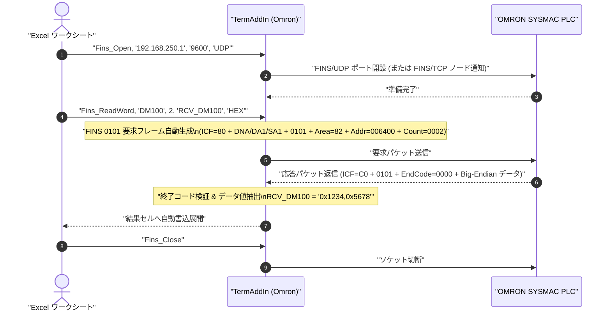



# TermAddIn_Omron - オムロン FINS / Sysmac 通信エクステンション

👉 [← TermAddIn 統合本体に戻る](https://github.com/Monaca-App/TermAddIn)  
👉 [← Monaca アプリ工房（トップ）に戻る](https://github.com/Monaca-App/store)

---

[](https://www.microsoft.com/)
[](https://www.microsoft.com/excel)
[](https://dotnet.microsoft.com/)
[]()
[]()

## 📖 概要

**TermAddIn_Omron** は、Excel 総合通信アドイン **TermAddIn** 上で動作する ** オムロン（OMRON）製 PLC（SYSMAC CS / CJ / CP / NJ / NX シリーズ）向け FINS / HostLink 通信専用エクステンション（機能ドメイン単一 DLL）** です。

オムロン製 PLC の内蔵 Ethernet ポート・Ethernet ユニット（CJ1W-ETN21 等）・RS-232C シリアルポートと、 **FINS/UDP（標準ポート 9600） ** 、 **FINS/TCP（自動ノードアドレス通知ハンドシェイク付き） ** 、および ** シリアル HostLink（上位リンク FA・Cモード、8ビット XOR FCS 自動計算）** を用いて高速・高信頼に直接交信します。

VBA マクロを一切記述することなく、 **標準の `.xlsx`（マクロ無効ブック）形式のままで SYSMAC 各種メモリエリア（DM, CIO, WR, HR, AR, EM, TIM, CNT）のワード・ビット一括読出・一括書込、および任意 FINS / HostLink 電文送受信** を安全に実行できます。

> [!NOTE]
> **利用前提とライセンス体系**  
> 本エクステンションは [TermAddIn 本体](https://github.com/Monaca-App/TermAddIn) 上で動作します。  
> TermAddIn ではプロトコル毎に個別ライセンスを設ける体系を採用しており、本機能のご利用には **`TermAddIn_Omron` 個別ライセンス（一括 ¥49,000 / 月額 ¥4,400 / 週額 ¥1,500・税別）** が適用されます（ライセンス未配置・無効時は、Excel ブック再オープン時の既存ボタン無効化、および `Term.exe` 単体起動時の 3 分間期間限定版として動作します）。

---

## ✨ 主な機能・特徴

1. **マルチトランスポート完全対応（FINS/UDP・FINS/TCP・シリアル HostLink）**
   * 高速・軽量な **FINS/UDP（ポート 9600） ** 、20/24 バイトのノードアドレス通知ハンドシェイクを自動処理する **FINS/TCP** 、および RS-232C シリアル経由の **HostLink（`@00FA...*\r` / Cモード・FCS 自動計算） ** を単一エンジンでシームレスに切り替え可能。 **[TermEmulator](https://github.com/Monaca-App/TermEmulator)** の OMRON FINS / HostLink 仮想スレーブ（Ethernet 直結、または `TermEmulator` ドライバレス仮想 COM ホスト／無償仮想シリアル中継ツール **[c2c](https://github.com/Monaca-App/c2c)** の仮想 COM ペア経由、本ライセンス共用可）とも実機なしで直結検証が可能。
2. **SYSMAC メモリエリア自動変換パーサー搭載**
   * `DM`（データメモリ）、`CIO`（入出力リレー）、`WR`（ワークエリア）、`HR`（保持リレー）、`AR`（補助記憶リレー）、`EM` / `E0_`〜`EC_`（拡張データメモリ）、`TIM`（タイマ）、`CNT`（カウンタ：`+0x8000` 自動オフセット）およびビット位置 `.00`〜`.15` を自動識別し、Big-Endian 電文へ正確にマッピング。
3. **メモリエリア一括読出（0101）/ 一括書込（0102）の専用最適化**
   * `Fins_ReadWord`, `Fins_WriteWord`, `Fins_ReadBit`, `Fins_WriteBit` により、10バイト FINS ヘッダ（ICF, DNA, DA1, SA1, SID 等）を意識することなくデバイス名と点数指定のみで直感的に制御可能。
4. **任意 FINS / HostLink コマンド送受信（Fins_Send / Fins_Receive）**
   * `0501`（コントローラ情報読出）、`0601`（CPU ステータス読出）、`0401`/`0402`（運転・停止）等の拡張 FINS コマンドや `@00MM` 等の Cモードコマンドも自在に送受信可能。
5. **Excel 32bit / 64bit 完全動作マトリクス**
   * .NET Framework 4.8 標準マネージド通信基盤のみで内製実装されており、外部の専用通信ミドルウェアやネイティブ DLL に依存しないため、Excel 32bit 版・64bit 版の双方で完全動作。

---

## 🔌 提供コマンド一覧（全 9 コマンド）

各コマンドの詳細な構文・パラメータ仕様・記述例は、以下の個別リファレンスをご参照ください。

### 回線制御・ルーティング設定コマンド（3 コマンド）

| コマンド名 | 構文概要 | 主な役割・用途 | 詳細マニュアル |
| :--- | :--- | :--- | :---: |
| **`Fins_Open`** | `Fins_Open, "[Endpoint]", "[PortOrOption]", "[Protocol]"` | FINS（UDP/TCP）または HostLink（Serial）回線を開設 | [詳細説明](./Manual/Omron/Fins_Open.Md) |
| **`Fins_Close`** | `Fins_Close` | 通信回線を安全に切断・リソース解放 | [詳細説明](./Manual/Omron/Fins_Close.Md) |
| **`Fins_Mode`** | `Fins_Mode, "[Protocol]", [DestNet], [DestNode], [SrcNode], [UnitNo]` | トランスポート方式および FINS ネットワーク・ノード番号設定 | [詳細説明](./Manual/Omron/Fins_Mode.Md) |

### デバイスアクセス・高水準コマンド（4 コマンド）

| コマンド名 | 構文概要 | 主な役割・用途 | 詳細マニュアル |
| :--- | :--- | :--- | :---: |
| **`Fins_ReadWord`** | `Fins_ReadWord, "[Device]", [Points], "[DestKey]", "[Format]"` | ワード（チャネル）一括読出（FINS 0101） | [詳細説明](./Manual/Omron/Fins_ReadWord.Md) |
| **`Fins_WriteWord`** | `Fins_WriteWord, "[Device]", "[Values]"` | ワード（チャネル）一括書込（FINS 0102） | [詳細説明](./Manual/Omron/Fins_WriteWord.Md) |
| **`Fins_ReadBit`** | `Fins_ReadBit, "[Device]", [Points], "[DestKey]"` | ビット状態一括読出（FINS 0101 ビット指定） | [詳細説明](./Manual/Omron/Fins_ReadBit.Md) |
| **`Fins_WriteBit`** | `Fins_WriteBit, "[Device]", "[Values]"` | ビット状態一括書込（FINS 0102 ビット指定） | [詳細説明](./Manual/Omron/Fins_WriteBit.Md) |

### 汎用 FINS / HostLink フレーム送受信コマンド（2 コマンド）

| コマンド名 | 構文概要 | 主な役割・用途 | 詳細マニュアル |
| :--- | :--- | :--- | :---: |
| **`Fins_Send`** | `Fins_Send, "[Frame]"` | 任意の FINS PDU または HostLink コマンドを直接送信 | [詳細説明](./Manual/Omron/Fins_Send.Md) |
| **`Fins_Receive`** | `Fins_Receive, "[DestKey]", "[Format]"` | 応答フレームを受信・終了コード／FCS 検証後にデータ抽出 | [詳細説明](./Manual/Omron/Fins_Receive.Md) |

---

## 💻 動作環境・システム要件

| 項目 | システム要件 |
| :--- | :--- |
| **OS** | Windows 10 / Windows 11 (64bit / 32bit) |
| **対応 Excel** | Microsoft Excel 2016 / 2019 / 2021 / Microsoft 365 (デスクトップ版 32bit / 64bit) |
| **必須アドイン** | [TermAddIn](https://github.com/Monaca-App/TermAddIn) (Excel VSTO アドイン) |
| **対象 PLC** | オムロン SYSMAC CS / CJ / CP / NJ / NX シリーズ（内蔵 Ethernet / FINS ポート、CJ1W-ETN21、シリアルユニット CJ1W-SCU 等） |
| **対応プロトコル** | OMRON FINS/UDP（Port 9600）、FINS/TCP（Port 9600）、シリアル HostLink 上位リンク（FA / Cモード） |

---

## 🚀 インストール手順

<a href="https://github.com/Monaca-App/TermAddIn_Omron/raw/main/Setup/TermAddIn_Omron_Setup.zip">
  
</a>

> 上記の **「プログラム（入手）」アイコン** をクリックすると、セットアッププログラム一式（[`TermAddIn_Omron_Setup.zip`](https://github.com/Monaca-App/TermAddIn_Omron/raw/main/Setup/TermAddIn_Omron_Setup.zip)）が直接ダウンロードされます。展開後、`TermAnalysis.Omron\setup.exe`（または `TermAnalysis.Omron.Setup.msi`）を実行してください。

> [!IMPORTANT]
> **導入前提**  
> 本エクステンションを利用するには、事前に **[TermAddIn 本体](https://github.com/Monaca-App/TermAddIn)** （`Term.Setup` および `TermAddIn.Setup`）をインストールしておく必要があります。

### 配布アーカイブ（本リポジトリ `Setup/` 配下）

* **アーカイブ**: [`Setup/TermAddIn_Omron_Setup.zip`](https://github.com/Monaca-App/TermAddIn_Omron/raw/main/Setup/TermAddIn_Omron_Setup.zip)（収録内容: `TermAnalysis.Omron/setup.exe`, `TermAnalysis.Omron/TermAnalysis.Omron.Setup.msi`）

### 導入ステップ

1. **Microsoft Excel** および **Term** をすべて終了します。
2. ダウンロードした **`TermAddIn_Omron_Setup.zip`** を展開し、 **`TermAnalysis.Omron/`** フォルダ内の **`setup.exe`** （または **`TermAnalysis.Omron.Setup.msi`** ）を実行します。
   * ※ 管理者権限（UAC 承認）が必要です。
   * ※ 拡張 DLL は共通インストール先（`C:\Program Files (x86)\Monacaアプリ工房\Monaca Common\`）へ配置され、サンプル資材が `C:\Program Files (x86)\Monacaアプリ工房\Monaca Sample\Omron\` へ導入されます。
3. インストール完了後、Excel（または `Term.exe`）を起動し、メイン画面の **`[通信モード]`** メニューから **`OMRON FINS`** が選択できることを確認します。

### アンインストール手順
* Windows の「設定」>「アプリ」>「インストールされているアプリ」（または「コントロールパネル」の「プログラムと機能」）から **`TermAnalysis.Omron.Setup`** を選択してアンインストールしてください。

---

## 🔄 通信シーケンスの概要

### FINS メモリエリア一括読出の流れ



---

## 🔰 シーケンス記述例・同梱サンプル資材（`Sample/Omron/`）

FINS/UDP を用いた SYSMAC データメモリ（`DM100`〜`DM101`）一括読出の構成例です。

```csv
; 1. OMRON FINS 通信回線をオープン（UDP/IP, Port 9600）
,SEQUENCE, 010, Fins_Open, "192.168.250.1", "9600", "UDP"
; 2. DM100 から 2 ワード一括読出を実行（16進形式）
,SEQUENCE, 020, Fins_ReadWord, "DM100", 2, "PLC_DM100", "HEX"
; 3. 通信回線をクローズして終了
,SEQUENCE, 030, Fins_Close
,SEQUENCE, 040, Exit
```

### 同梱サンプルマクロ・AI自動生成プロンプト集
FINS/UDP・FINS/TCP・シリアル HostLink に対応した動作確認用マクロスクリプト（CSV）および AI 自動生成プロンプトが **`Sample/Omron/`** に収録されています（インストール時には `C:\Program Files (x86)\Monacaアプリ工房\Monaca Sample\Omron\` へ配置され、デスクトップの `Monaca\Sample` ショートカットから参照できます）。

* **[`Sample/Omron/Omron_FINS.csv`](./Sample/Omron/Omron_FINS.csv)**: OMRON FINS / HostLink 汎用マクロスクリプトサンプル
* **[`Sample/Omron/Omron_FINS_prompt.md`](./Sample/Omron/Omron_FINS_prompt.md)**: OMRON FINS / HostLink 用マクロスクリプト AI 自動生成プロンプト

---

## 💳 ライセンス・購入プラン（TermAddIn_Omron）

> [!NOTE]
> **試用動作およびオンライン決済について**  
> ライセンス未配置・無効時は、Excel ブック再オープン時の既存ボタン無効化（新規追加ボタンのみ試用可能）、および `Term.exe` 単体起動時の 3 分間期間限定版として動作します。  
> 用途や利用期間に合わせて、一括購入（買い切り）またはサブスクリプション（月額・週額）からお選びいただけます。メールアドレスの誤入力によるライセンス不着を防ぐため、 **事前のメールアドレス確認** を行った上で、 **Stripe** による安全なオンライン決済へご案内いたします（表記価格はすべて税別です）。

| プラン | 価格（税別） | お支払い・お申込み |
| :--- | :---: | :---: |
| **一括購入（買い切りライセンス）**<br>無期限で永続利用できるライセンスです。 | **¥49,000** | [👉 一括購入手続きへ](https://stripe-license-generator.y-nakai-5a3.workers.dev/?target=omron) |
| **月額サブスクリプション**<br>月単位で利用できる定期プランです。中長期のプロジェクトにおすすめです。 | **¥4,400** / 月 | [👉 月額プランに申し込む](https://stripe-license-generator.y-nakai-5a3.workers.dev/?target=omron) |
| **週額サブスクリプション**<br>週単位で手軽に利用できるプランです。短期評価や単発テストにおすすめです。 | **¥1,500** / 週 | [👉 週額プランに申し込む](https://stripe-license-generator.y-nakai-5a3.workers.dev/?target=omron) |

* ※ **ライセンスファイル名**: `TermAddIn_Omron.License`
* ※ **配置先**: `%USERPROFILE%\Desktop\Monaca\TermAddIn_Omron.License`（設定ファイル `Setting.xml` と同階層）
* ※ **ライセンス形態**: 1 ユーザー / 1 PC（ノードロック方式：`PC名` および `ログインユーザー名` に紐づけ）

---

## 📄 ライセンス & サポート

* **開発元**: [Monaca アプリ工房 (Monaca App Store)](https://github.com/Monaca-App/store)
* **親プロジェクト**: [TermAddIn](https://github.com/Monaca-App/TermAddIn)
* **関連ツール・シミュレータ**: [TermEmulator - 汎用仮想デバイス＆PLCスレーブ・エミュレータ](https://github.com/Monaca-App/TermEmulator) ／ [c2c - ドライバ不要の仮想ヌルモデム＆通信モニター](https://github.com/Monaca-App/c2c)
* **Copyright**: Copyright (C) Monaca App Store 2026 All rights reserved.
* **お問い合わせ**: 不具合報告や機能要望は、GitHub の Issue までお気軽にお寄せください。

